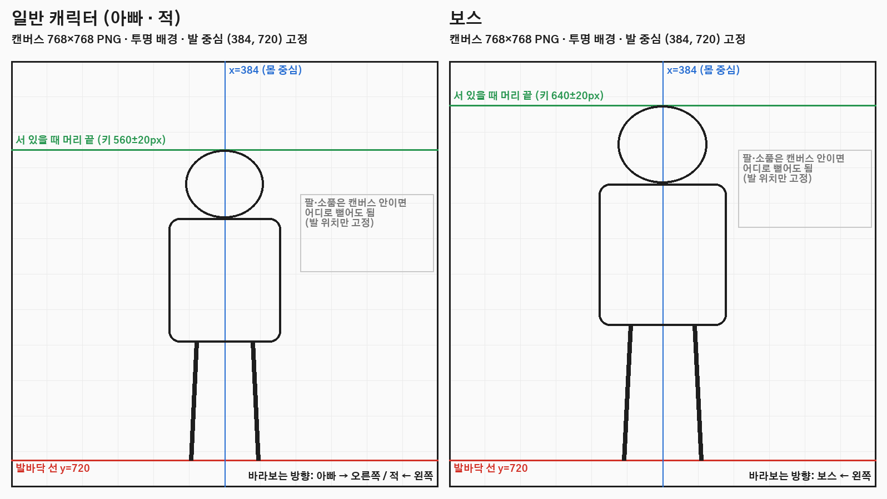
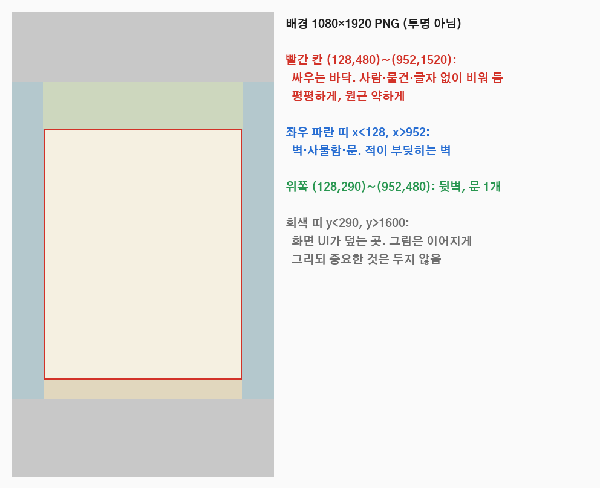

# 에셋 요청서 v5

2026-11-04. 구성 설계 v5([dad-structure-v5.md](dad-structure-v5.md))를 구현하는 데 필요한 그림·소리 목록이다.

## 납품·적용 결과 (2026-11-04)

- **수량:** 요청한 묶음이 모두 들어왔다(UI 21, 장비 18, 캐릭터 9종 63프레임 + 소품 2, 배경 3, 만화 3, 앱 아이콘 1, 소리 21). 납품 설명은 `Assets/DadSchoolBoss/Art/V5/DELIVERY-README.md`, 소리 라이선스는 `AUDIO-LICENSES.txt`(직접 합성, CC0)에 있다.
- **규격 점검:** 크기·투명도·여백·발 피벗을 통과했다. 보스 돌진 3장은 몸을 던지는 자세라 발 중심이 옆으로 치우쳐 있는데, 화면에서 자연스러워 그대로 쓴다. 아빠의 서 있기·걷기 키는 536~573px로 차이가 있지만 재생에서 튀지 않았다.
- **위치·가져오기 설정:** 파일은 `Assets/DadSchoolBoss/Resources/DadV5/`에 두었다. `Editor/DadV5AssetImport.cs`가 설정을 자동으로 맞춘다: 캐릭터 512px 압축, 아이콘 256px, 배경 2048px, 배경음 스트리밍(Vorbis), 효과음 ADPCM.
- **적용한 곳:**
  - 캐릭터 동작 프레임
  - 층별 배경
  - 효과음·배경음
  - 홈 재화·강화·별 아이콘
  - 앱 아이콘(PlayerSettings)
- **아직 안 쓰는 것:**
  - 장비 아이콘 18개 (5단계 도시락 화면)
  - 탭·홈 버튼 아이콘 일부 (4단계 홈·탭)
  - 3컷 만화 (7단계 첫 실행)
  - 피구 짱 (3층 원거리 적 로직이 아직 없음)
 만들어진 파일은 아래 폴더 구조로 넣고 경로만 알려 주면 Unity에 연결한다.

```
~/Desktop/dad-assets/
  ui/        P0 아이콘 21개
  gear/      P0 장비 18개
  chars/     P1·P2 캐릭터 (캐릭터별 하위 폴더: dad, gum, chair, tray, boss1, boss2, boss3, dodge)
  bg/        P2 배경
  story/     P3 3컷 만화
  app/       P3 앱 아이콘
  audio/     P3 소리
```

## 우선순위

| 순위 | 묶음 | 수량 | 쓰는 곳 |
| --- | --- | ---: | --- |
| **P0** | UI 아이콘 + 장비 아이콘 | 39 | 홈·탭·강화·도시락·상점·결과 화면 (구현 4~6단계) |
| **P1** | 기존 캐릭터 동작 프레임 + 껌 짱 재제작 | 41 프레임 | 걷기·피격·날아감 연출(v4 M2·M3·M5), 성인화 |
| **P2** | 2·3층: 배경 3, 보스 2, 원거리 적 1 | 3 + 22 프레임 + 소품 | 2층 급식실, 3층 체육관 |
| **P3** | 3컷 만화, 앱 아이콘, 소리 | 3 + 1 + 소리 | 첫 실행, 스토어, 타격감 |

P0만 있어도 화면 구현은 시작할 수 있다. 그동안 기존 그림으로 기능을 먼저 만든다.

## 공통 규칙

- **형식:** PNG.
  - 캐릭터·아이콘·소품: 진짜 투명 배경 (흰 배경이나 체크무늬 그림 금지)
  - 배경·만화·앱 아이콘: 불투명
- **글자 금지:** 그림 안에 글자·숫자·로고를 넣지 않는다. 모든 글자는 Unity가 그린다. AI 생성 한글은 깨진다.
- **화풍:** 지금 적 4종(`Assets/DadSchoolBoss/Resources/DadV2/Enemies.png`)과 같게 한다.
  - 굵고 불규칙한 검은 외곽선, 평평한 색, 그림자는 딱 1단계
  - 일부러 못생기고 웃긴 싸구려 웹툰 / 중국 양산형 방치 게임 느낌
  - 그라데이션·광택·세밀한 머리카락·옷 주름 금지
- **사람은 전원 성인이다** (v4 4.5절).
  - 나이 단서를 2개 이상 넣는다: 벗겨진 이마, 이마 주름, 수염 자국, 흰머리, 처진 볼, 배.
  - 교복·책가방·학생 명찰은 쓰지 않는다. 마른 몸 + 큰 눈 + 매끈한 얼굴 조합도 쓰지 않는다.
- **효과·바닥 그림자 금지:** 타격 효과와 그림자는 코드가 그린다.
- **파일명:** 아래 표의 이름 그대로, 영문 소문자와 밑줄만 쓴다.

## AI 이미지 도구용 공통 스타일 문구

모든 요청 앞에 붙인다. 기존 `Enemies.png`나 `Hero.png`를 참고 이미지로 같이 넣으면 화풍이 잘 맞는다.

```text
Style: intentionally ugly, funny, cheap Korean web comic / Chinese mass-market idle mobile game. Thick irregular black outlines, flat muted solid fills, exactly ONE hard shadow tone, simple hair masses, few clothing lines, very expressive faces. Adults only, 3.5 to 4 heads tall. No gradients, no glossy highlights, no painterly texture, no cute chibi, no anime hero, no text, no letters, no numbers, no watermark, no ground shadow, no effects. Genuinely transparent background.
```

---

## P0-A. UI 아이콘 21개 (`ui/`)

- **규격:** 256×256, 투명, 물체는 가운데, 여백 16px 이상, 외곽선 약 10px.
- **배경판 없음:** 버튼·테두리는 코드가 그린다.

| 파일명 | 그림 | 쓰는 곳 |
| --- | --- | --- |
| `icon_coin.png` | 낡은 금색 동전 한 개, 가운데 주먹 문양 | 재화 표시 |
| `icon_lunchbox.png` | 보자기로 묶은 2단 도시락통 | 재화 표시 |
| `tab_shop.png` | 동네 슈퍼 줄무늬 차양 | 하단 탭 |
| `tab_lunchbox.png` | 뚜껑이 열리며 빛나는 도시락통 | 하단 탭 |
| `tab_go.png` | 앞으로 내지르는 아빠 주먹 | 하단 탭 가운데 큰 버튼 |
| `tab_upgrade.png` | 불끈 솟은 팔뚝 알통 | 하단 탭 |
| `tab_school.png` | 낡은 3층 학교 건물 정면 | 하단 탭 |
| `up_fist.png` | 붕대 감은 주먹 | 강화: 주먹 |
| `up_hp.png` | 빨간 하트에 붙인 파스 | 강화: 체력 |
| `up_combo.png` | 잔상이 겹친 주먹 세 개 | 강화: 연타 |
| `up_launch.png` | 하늘로 날아가는 슬리퍼 한 짝과 궤적 | 강화: 날리기 |
| `btn_free_lunchbox.png` | 리본 묶은 도시락 선물 | 홈: 무료 도시락 |
| `btn_awaken.png` | 이마에 핏대 선 화난 아빠 얼굴 | 홈: 아빠 각성 |
| `btn_idle_chest.png` | 동전이 넘치는 보온 도시락 가방 | 홈: 방치 보상 |
| `btn_attendance.png` | 동그라미 친 벽걸이 달력 | 홈: 출석 (출시 후) |
| `star_full.png` | 노란 별 | 스테이지 별 |
| `star_empty.png` | 같은 모양의 빈 회색 별 | 스테이지 별 |
| `lock.png` | 낡은 자물쇠 | 잠긴 층·기능 |
| `mom_call.png` | 진동하는 폴더폰 (화면에 하트) | 부활 "엄마 전화 찬스" |
| `mom_cheer.png` | 국자를 흔드는 엄마 손 | 막힘 보정 "엄마의 응원" |
| `distance.png` | 쭉 늘어난 줄자 | 비거리 기록 |

## P0-B. 장비 아이콘 18개 (`gear/`)

- **규격:** 256×256, 투명.
- **등급:** 장비 그림은 하나만 만든다. 등급 색 테두리는 코드가 그린다.

| 부위 | 1 | 2 | 3 |
| --- | --- | --- | --- |
| 신발 `gear_shoes_*` | 고무 슬리퍼 | 삼선 슬리퍼 | 낡은 등산화 |
| 손 `gear_hand_*` | 목장갑 | 빨간 고무장갑 | 낡은 권투 글러브 |
| 상의 `gear_top_*` | 초록 조끼 | 누런 런닝셔츠 | 주머니 많은 낚시 조끼 |
| 머리 `gear_head_*` | 돋보기 안경 | 아저씨 선글라스 | 등산 모자 |
| 소지품 `gear_item_*` | 폴더폰 | TV 리모컨 | 둘둘 만 신문지 |
| 생활용품 `gear_tool_*` | 효자손 | 장우산 | 골프채 |

파일명 예: `gear_shoes_1.png`, `gear_tool_3.png`

---

## P1. 캐릭터 동작 프레임 (`chars/`)



- **규격:** 프레임마다 **768×768 PNG 한 장**, 투명 배경.
- **발 위치:** 발 중심을 **(384, 720)에 고정**한다. 날아가는 프레임만 예외로, 몸 중심을 캔버스 가운데쯤에 둔다.
- **키:** 서 있을 때 일반 캐릭터 560±20px, 보스 640±20px. 같은 캐릭터의 모든 프레임은 같은 축척이어야 한다.
- **방향:** 아빠는 오른쪽, 적·보스는 왼쪽을 본다. 반대 방향은 코드가 뒤집는다.
- **일관성:** 얼굴·옷·색·체형이 모든 프레임에서 같아야 한다.
- **만드는 요령:** 한 캐릭터의 포즈를 한 이미지에 나란히 생성하면 일관성이 좋다.
  - 그렇게 받은 시트도 괜찮다. 같은 축척, 같은 바닥선, 포즈 사이 투명 간격만 지켜 주면 768 캔버스로 자르고 맞추는 건 내가 한다.
  - 날아가는 프레임은 같은 시트에 넣지 말고 따로 만든다.

### 아빠 `chars/dad/` (12장): 기존 `Hero.png`의 아빠와 같은 사람

| 파일명 | 포즈 |
| --- | --- |
| `dad_idle_0`, `dad_idle_1` | 귀찮은 표정으로 서 있기. 1은 숨 쉬며 어깨가 살짝 내려간 모습 |
| `dad_walk_0`~`dad_walk_3` | 걷기 한 바퀴: 왼발 접지 → 지나감 → 오른발 접지 → 지나감. 슬리퍼를 질질 끄는 느낌 |
| `dad_punch_0` | 주먹을 뒤로 당긴 준비 |
| `dad_punch_1` | 팔을 끝까지 뻗은 명중 순간. 과장되게 길게 |
| `dad_punch_2` | 친 뒤 몸이 앞으로 쏠린 반동 |
| `dad_special_0` | "아빠 화났다": 양팔을 벌리고 포효, 넥타이가 휘날림 |
| `dad_hurt_0` | 맞고 뒤로 젖혀짐, 눈 질끈 |
| `dad_win_0` | 도시락을 높이 들고 무심한 표정 |

### 기존 적 4종: 지금 `Enemies.png`의 인물을 그대로 두고 동작만 추가

**껌 짱 `chars/gum/` (6장): 34세로 재제작**
- 기존 얼굴을 버리고 새로 만든다.
- 벗겨지는 이마에 기름진 뾰족 머리, 이마 주름, 짙은 수염 자국, 눈 밑 다크서클, 처진 볼, 올챙이배.
- 바랜 주황 트레이닝 상의 안에 얼룩진 런닝, 헐렁한 남색 트레이닝 바지, 닳은 슬리퍼. 분홍 껌 풍선.

| 캐릭터 | 프레임 (파일명 `<폴더명>_<동작>_<번호>.png`) |
| --- | --- |
| 껌 짱 `gum` | `walk_0`, `walk_1`, `attack_0`(손을 들어 올린 준비), `attack_1`(손바닥 휘두르기), `hit_0`(맞고 고개 젖힘), `fly_0`(대자로 날아감) |
| 의자 짱 `chair` | `walk_0`, `walk_1`, `windup_0`(접이식 의자를 머리 위로), `dash_0`(의자 들고 앞으로 돌진), `hit_0`, `fly_0` |
| 쟁반 짱 `tray` | `walk_0`, `walk_1`, `block_0`(쟁반을 앞으로 들고 버팀), `attack_0`(쟁반으로 내려치기), `hit_0`, `fly_0` |
| 쟁반 짱 쟁반 없이 | `tray_notray_walk_0`, `tray_notray_walk_1`, `tray_notray_hit_0` (빈손으로 당황한 표정) |
| 학교 짱 `boss1` | `walk_0`, `walk_1`, `windup_0`(어깨 숙이고 돌진 준비), `dash_0`, `groggy_0`(눈이 빙글빙글, 비틀거림), `hit_0`, `enrage_0`(얼굴 빨개져 포효), `fly_0` |

추가 소품: `chars/tray/prop_tray_dented.png`. 256×256 투명, 찌그러진 급식 쟁반 하나로, 쟁반이 깨질 때 날아가는 파편으로 쓴다.

**껌 짱 재제작 프롬프트** (공통 스타일 문구 뒤에 붙임):

```text
One original adult enemy, 34-year-old perpetual college dropout who never left the school, clearly middle-aged, NOT a teenager. Receding hairline with thin greasy spiky hair, forehead wrinkles, heavy stubble, tired eye bags, sagging cheeks, small beer belly, slouching. Faded orange track jacket open over a stained undershirt, baggy navy track pants, worn slippers, blowing a pink bubble-gum bubble with a smug face. Facing three-quarter LEFT. Same line weight and palette as the attached enemy sheet. Poses in one row, same scale, same ground line, clear transparent gaps: walk A, walk B, raising hand to slap, slapping, head snapped back from a hit.
```

---

## P2. 2·3층 콘텐츠

### 배경 3장 (`bg/`)



- **규격:** **1080×1920** (세로 화면 그대로), 불투명.
- **가운데 바닥 (128,480)~(952,1520):** 싸우는 바닥이다. 사람·물건·글자 없이 비우고, 원근은 약하고 평평하게 한다.
- **좌우 x<128, x>952:** 적이 부딪히는 벽이다. 사물함·문·창문을 둔다.
- **위 (128,290)~(952,480):** 뒷벽과 문 1개.
- **위아래 끝(y<290, y>1600):** UI가 덮는 곳이다. 그림은 이어서 그리되 중요한 건 두지 않는다.

| 파일명 | 장소 | 벽 쪽 물건 |
| --- | --- | --- |
| `bg_floor1_corridor.png` | 1층 복도 (지금 배경을 비율에 맞게 다시) | 사물함, 교실 문, 초록 페인트 띠 |
| `bg_floor2_cafeteria.png` | 2층 급식실 | 배식대, 대형 밥솥, 식판 수레, 창문 |
| `bg_floor3_gym.png` | 3층 체육관 | 농구 골대, 뜀틀, 매트 더미, 공 바구니 |

### 새 보스 2명 (`chars/boss2/`, `chars/boss3/`): 학교 짱과 같은 8장 구성

| 보스 | 설정 | 생김새 | 특수 프레임 |
| --- | --- | --- | --- |
| 급식실 실세 `boss2` | 52세, 30년째 급식 조리 중 | 거대한 체구, 위생모와 마스크를 턱에 걸침, 흰 조리복에 얼룩진 앞치마, 대형 국자, 팔뚝 문신 지운 자국 | `windup_0`: 국자를 크게 휘두를 준비 |
| 체육 선생님 `boss3` | 51세, 만년 기간제 | 대머리에 옆머리만 길게, 빛바랜 파란 트레이닝복, 목에 호루라기, 겨드랑이에 피구공 | `windup_0`: 호루라기를 물고 피구공을 들어 올림 |

### 원거리 적: 피구 짱 `chars/dodge/` (6장 + 공)

- **설정:** 38세, 동네 피구 동호회장 (자칭 국가대표).
- **생김새:** 땀띠 난 얼굴, 헤어밴드, 쫄쫄이 반바지, 무릎 보호대, 배.
- **프레임:** `walk_0`, `walk_1`, `throw_0`(공을 뒤로 젖힌 준비), `throw_1`(던진 순간), `hit_0`, `fly_0`
- **소품:** `prop_dodgeball.png` 128×128 투명, 빨간 고무 피구공.

중간 보스(왕 껌 짱·왕 쟁반 짱·왕 의자 짱)는 기존 그림을 크기·색만 바꿔 쓰므로 새로 그리지 않는다.

---

## P3. 출시 준비

### 3컷 만화 (`story/`): 각 1080×1350, 불투명, 글자 없음

| 파일명 | 장면 |
| --- | --- |
| `intro_1.png` | 아침 식탁. 아들이 가방 메고 뛰쳐나가고, 식탁 위에 도시락이 덩그러니 |
| `intro_2.png` | 엄마가 도시락을 아빠 가슴팍에 들이밀고, 런닝셔츠 차림 아빠가 귀찮은 표정 |
| `intro_3.png` | 학교 정문. 담장과 옥상에 아저씨 짱들이 진을 치고, 슬리퍼 차림의 아빠가 도시락을 들고 서 있음 |

### 앱 아이콘 (`app/`)

- `app_icon.png` 1024×1024, 불투명.
- 아빠 얼굴 클로즈업 + 슬리퍼 한 짝, 파란 방사형 배경(원시인 형님들 아이콘의 크게 박힌 얼굴 문법).
- 모서리를 둥글게 깎지 않는다(스토어가 자른다). 글자는 넣지 않는다.

### 소리 (`audio/`)

- **형식:** WAV 44.1kHz 16bit 또는 OGG. 효과음은 모노, 0.1~1초, 앞쪽 무음 없이.
- **라이선스:** 상업적 사용 가능(CC0 또는 구매)이어야 한다. 출처를 `audio/LICENSES.txt`에 적는다.

| 파일명 | 소리 |
| --- | --- |
| `sfx_punch_1`~`3` | 둔탁한 펀치 3종 |
| `sfx_wall_1`~`2` | 사물함에 쾅 부딪힘 (철판 울림) |
| `sfx_chain` | 사람끼리 부딪히는 퍽 |
| `sfx_tray_block` / `sfx_tray_break` | 쟁반 막기 "팅" / 쟁반 찌그러짐 |
| `sfx_chair_dash` | 의자 들고 돌진하는 휙 |
| `sfx_boss_enrage` | 보스 포효 |
| `sfx_coin` | 동전 줍기 |
| `sfx_skill_pick` | 잔기술 선택 |
| `sfx_button` | 버튼 누름 |
| `sfx_box_common` / `sfx_box_rare` / `sfx_box_legend` | 도시락 열기 (등급별로 점점 화려하게) |
| `sfx_revive` | 부활 |
| `jingle_win` / `jingle_lose` | 승리 / 패배 짧은 음악 (2~4초) |
| `bgm_battle` / `bgm_home` | 전투 / 홈 배경음, 60~90초 반복 |

---

## 넣기 전 점검표

- [ ] 투명 배경이 진짜 투명이다 (체크무늬 그림이 아니다)
- [ ] 그림 안에 글자·숫자·로고가 없다
- [ ] 같은 캐릭터의 얼굴·옷·색·축척이 모든 프레임에서 같다
- [ ] 발이 (384, 720)에 있다 (날아가는 프레임 제외)
- [ ] 아빠는 오른쪽, 적은 왼쪽을 본다
- [ ] 모든 사람에게 나이 단서가 2개 이상 있고, 교복이 없다
- [ ] 파일명이 표와 같다
