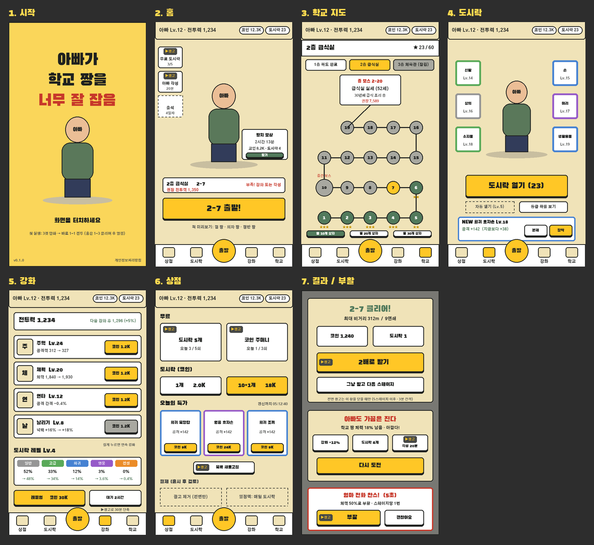

# 아빠가 학교 짱을 너무 잘 잡음 — 구성 설계 v5 (화면·스테이지·상점·강화·난이도)

2026-11-04. 재기획 v4([dad-redesign-v4.md](dad-redesign-v4.md))의 "짧은 자동 전투 + 아빠 키우기 + 보상형 광고" 방향을 화면과 숫자로 구체화한다.

## 0. 요약

- **화면 7종:** 시작, 홈, 학교 지도(스테이지 선택), 도시락(장비), 강화, 상점, 결과·부활. 하단 탭 5개(상점·도시락·출발·강화·학교)로 오간다. 처음부터 다 보여주지 않고 첫 세션 동안 하나씩 연다.
- **스테이지:** 층당 20개(10번째 중간 보스, 20번째 층 보스). 첫 출시는 3층 60스테이지다.
  - 진행 시뮬레이션에서 하루 약 32분 플레이로 첫날 약 30스테이지를 소비했다. 층당 10개로는 첫날 콘텐츠가 바닥난다.
- **난이도:** 톱니 모양이다. 층 안에서 오르고, 보스에서 튀고, 다음 층 첫 스테이지에서 내려간다. 내려가는 구간이 "아빠가 너무 잘 잡는" 압도감을 준다.
- **광고:** 보스 벽 앞에서 지름길이 된다. 시뮬레이션상 벽이 없으면 광고의 가치가 0이고, 오히려 광고를 보는 사람이 시청 시간만큼 느려진다.
  - 같은 보스에 거듭 지면 무료 버프(엄마의 응원)를 쌓아 광고 없이도 결국 넘게 한다.
- **숫자의 성격:** [Tools/progression_sim.py](../Tools/progression_sim.py)로 맞춘 1차 가설이다. 출시 후 실제 시도 횟수·리텐션으로 다시 맞춘다.

## 1. 화면 흐름



```
시작 ─(첫 실행)→ 3컷 만화 → 1-1 전투 → 1-2 → 1-3 → 홈 열림
  └(이후)→ 홈 ⇄ 하단 탭 [상점 | 도시락 | 출발 | 강화 | 학교]
                    출발 → 전투 → (패배 직전) 부활 제안 → 결과(성공 / 실패)
                                                    성공: 2배 받기 → 다음 스테이지 / 홈
                                                    실패: 강화·도시락·각성 추천 → 다시 도전
```

### 1.1 첫 세션 해금 순서

한 번에 메뉴를 다 보여주지 않고 하나씩 연다. Capybara Go가 챕터 진행에 따라 기능을 단계적으로 연다 [v4 출처 7].

| 시점 | 열리는 것 | 안내 한 줄 |
| --- | --- | --- |
| 첫 실행 | 3컷 만화(아들이 도시락을 두고 감 → 아빠 출동) → 바로 1-1 | "손을 떼면 아빠가 알아서 칩니다" |
| 1-3 클리어 | 홈, 강화 탭 | "코인으로 주먹을 키우세요" (첫 강화 무료) |
| 1-5 클리어 | 도시락 탭 | 첫 도시락은 고급 등급 확정 |
| 1-8 클리어 | 첫 보상형 제안(결과 2배) | 첫 접속 약 5분 무렵 |
| 1-10 중간 보스 | 홈 `아빠 각성` 버튼 | 전투력이 모자랄 때만 강조 |
| 1-15 | 상점 | 무료 도시락(광고) 안내 |
| 1-20 층 보스 클리어 | 학교 지도, 2층 공개 | 다음 보스 실루엣 + 나이 공개 |
| 2-1 이후, 첫 실행 10분 이후 | 전면 광고 시작 | (v4 5.2절 규칙) |

## 2. 화면별 설계

### 2.1 시작

- 로고, 아빠, "화면을 터치하세요", 버전, 개인정보처리방침 링크(광고 SDK를 쓰면 필요)
- 첫 실행만 3컷 만화로 이어진다. 기존 Alley 프롤로그(잉크 컷 + 낭독) 코드를 다시 쓸 수 있다.

### 2.2 홈 (출발 탭)

| 구역 | 내용 | 광고 |
| --- | --- | --- |
| 상단 띠 | 아빠 레벨·전투력, 코인, 도시락 수 | |
| 왼쪽 버튼 | 무료 도시락(남은 횟수), 아빠 각성(남은 시간), 출석(출시 후) | 무료 도시락·각성 |
| 가운데 | 아빠(장비가 겉모습에 반영), 방치 보상 상자(쌓인 시간·양) | 방치 2배 |
| 출발 카드 | 현재 스테이지, 권장 전투력. 부족하면 빨간 글씨 "강화 또는 각성" | |
| 큰 버튼 | `2-7 출발!` | |
| 하단 | 적 미리보기 한 줄, 탭 5개 | |

### 2.3 학교 지도 (스테이지 선택)

- 층 탭: 완료 / 진행 중 / 잠김.
- 한 층의 20개 스테이지를 아래에서 위로 굽이치는 길로 그린다. 꼭대기는 층 보스 카드(이름·나이·한 줄 설정·권장 전투력)다.
- 노드 상태: 깬 곳(별 표시), 현재(노랑), 잠김(회색). 10번째는 중간 보스로 크게 그린다.
- 깬 스테이지는 다시 할 수 있다. 별 3개를 노리는 반복 동기다.
- 아래쪽: 별 10·20·30개 보상 상자.
- 다음 층 보스는 실루엣과 나이만 보여 궁금하게 만든다.

### 2.4 도시락 (장비)

- 가운데 아빠, 양옆에 6부위 슬롯(신발·손·상의·머리·소지품·생활용품). 등급 색 테두리를 쓴다.
- 큰 `도시락 열기 (23)` 버튼을 누르면 결과 카드가 나온다. 현재 장비와 수치 차이를 보여 주고 `분해`(코인) / `장착`을 고른다.
- 도시락 레벨 5부터 자동 열기와 필터를 연다(疯狂骑士团은 상자 Lv20에 자동 열기 [v4 출처 6]).
- `등급 확률 보기`로 확률을 공개한다(v4 5.1절).

### 2.5 강화

| 항목 | 효과 | 전투 시뮬레이션 연결 |
| --- | --- | --- |
| 주먹 | 공격력 | `baseDamage`, 펀치 넉백 |
| 체력 | 최대 체력 | `maxHealth` |
| 연타 | 공격 간격 단축 | 공격 쿨다운 배율 |
| 날리기 | 넉백 거리 | `punchKnockbackMultiplier`. 손맛 담당 스탯이다. 비거리 기록이 늘어난다 |

- 각 줄에 현재 → 다음 값, 비용, 강화 버튼을 둔다. 길게 누르면 연속 강화한다. 상단에는 강화 후 전투력을 미리 보여 준다.
- **도시락 레벨:** 등급 확률표(현재 → 다음)를 보여 준다. 레벨업은 코인 + 대기 시간(예: 2시간)이고, 광고 1회에 30분 단축(하루 3회)이다.

| 도시락 Lv | 일반 | 고급 | 희귀 | 영웅 | 전설 |
| ---: | ---: | ---: | ---: | ---: | ---: |
| 1 | 70% | 25% | 5% | 0% | 0% |
| 2 | 62% | 30% | 7.5% | 0.5% | 0% |
| 3 | 57% | 31% | 10% | 2% | 0% |
| 4 | 52% | 33% | 12% | 3% | 0% |
| 5 | 48% | 34% | 14% | 3.6% | 0.4% |

(1차 초안. 확률은 게임 안에 그대로 공개한다.)

### 2.6 상점

| 칸 | 내용 | 한도 |
| --- | --- | --- |
| 무료 (광고) | 도시락 5개 / 코인 주머니 | 하루 5회 / 3회 |
| 도시락 (코인) | 1개, 10+1개 | 없음 |
| 오늘의 특가 | 장비 3칸(코인), 매일 갱신 | 광고로 새로고침 하루 1회 |
| 결제 (출시 후 검토) | 광고 제거(전면만), 월정액(매일 도시락) | |

### 2.7 결과·부활

- **성공:** 스테이지·비거리·연쇄 기록 → 보상(코인·도시락) → `2배로 받기`(광고)가 가장 크다 → `그냥 받고 다음 스테이지`. 전면 광고는 이 창을 닫을 때만 뜬다(v4 5.2절).
- **실패:** "아빠도 가끔은 진다" + **보스 남은 체력**("18% 남음 · 아깝다!")을 보여 준다. 추천 3개(강화 +12% / 도시락 4개 / 각성 20분)를 띄우고 `다시 도전`을 둔다.
- **부활 (전투 중):** 쓰러지는 순간 "엄마 전화 찬스! (5초)"가 뜬다. 체력 50%로 부활하고, 스테이지당 1번이다. `괜찮아요`를 누르면 바로 결과로 간다.

## 3. 스테이지 구조

### 3.1 층과 보스 (모두 성인, v4 4.5절)

| 층 | 장소 | 중간 보스 (10) | 층 보스 (20) | 새 규칙 | 그림 |
| --- | --- | --- | --- | --- | --- |
| 1층 | 복도 | 왕 껌 짱 (껌 풍선이 터지면 주변 밀어냄) | 학교 짱 (42세, 15년째 유급) | 벽꿍·연쇄 기본, 돌진 예고 | 기존 + 껌 짱 재제작 |
| 2층 | 급식실 | 왕 쟁반 짱 | 급식실 실세 (52세, 30년째 급식 조리) | 쟁반 정면 방어 | **보스·배경 신규** |
| 3층 | 체육관 | 왕 의자 짱 | 만년 기간제 체육 선생님 (51세) | 피구공 던지는 원거리 적 | **보스·배경·원거리 적 신규** |
| 4층(출시 후) | 교무실 | — | 교감 (58세) | — | 신규 |

중간 보스는 기존 적을 1.6배 크기·전용 색·체력 배율로 키운 엘리트다. 그림을 새로 만들지 않는다.

### 3.2 한 스테이지

- **일반:** 30~45초, 웨이브 2~3개, 적 10~18명.
- **보스:** 60~75초. 보스 + 졸개 보급(v3 그로기 규칙)이다.
- **적 수치:** 권장 전투력에 맞춰 체력·피해 배율을 정한다. 전투 시뮬레이션은 지금 것을 그대로 쓴다.
- **별 3개:**
  - ★ 클리어
  - ★★ 체력 50% 이상으로 클리어
  - ★★★ 마무리 비거리 X m 이상 또는 N연쇄
  - 드래그로 잘 치는 사람의 보상이다. 다시 할 이유가 된다.

## 4. 난이도 곡선

### 4.1 모양

| 스테이지 | 1-1 | 1-9 | **1-10** | 1-11 | 1-19 | **1-20** | 2-1 | **2-10** | **2-20** | 3-1 | **3-10** | **3-20** |
| --- | ---: | ---: | ---: | ---: | ---: | ---: | ---: | ---: | ---: | ---: | ---: | ---: |
| 권장 전투력 | 72 | 165 | **239** | 204 | 471 | **941** | 493 | **1,930** | **7,589** | 3,978 | **15,563** | **61,187** |

- 층 안에서는 스테이지마다 11%씩 오른다.
- 중간 보스는 1.3배, 층 보스는 1.8배로 튄다.
- 다음 층 첫 스테이지는 0.85배로 내려간다. 보스를 넘은 직후 몇 스테이지는 쉽게 쓸어버리는 구간이 된다.

### 4.2 1차 수치 (`Tools/progression_sim.py`)

| 항목 | 값 |
| --- | --- |
| 권장 전투력 | 72 × 1.11^(스테이지−1), 중간 보스 ×1.3, 층 보스 ×1.8, 층 첫 스테이지 ×0.85 |
| 승률 | 0.5 + 2.5 × (전투력/권장 − 1), 3~99%로 제한. 같으면 50%, 20% 높으면 확실 |
| 강화 | 비용 30 × 1.10^레벨, 레벨당 전투력 +5% (4종을 돌아가며 올린다고 가정) |
| 코인 | 클리어 40 × 1.12^(스테이지−1), 보스 ×3, 실패 30%, 이전 스테이지 반복 50% |
| 도시락 | 클리어당 1개, 층 보스 첫 클리어 10개, 방치 시간당 2개 |
| 장비 효과 | 전투력 × (1 + 0.35 × ln(1 + 연 도시락 수/10)) |
| 방치 | 시간당 "최근 스테이지 8회 클리어"분 코인, 최대 8시간 |
| 막힘 보정 | 같은 스테이지 3패부터 실패마다 +5%, 최대 +25% (엄마의 응원) |
| 각성(광고) | 20분간 실효 전투력 +25%, 하루 3회(적극형 기준) |

### 4.3 결과 (시드 200개 중앙값)

| 날짜 | 광고 안 봄 | 광고 가끔 (하루 3~4회) | 광고 적극 (하루 12~20회) |
| --- | --- | --- | --- |
| 1일차 | 2-10 | 2-10 | 2-6 |
| 2일차 | 3-6 | 3-10 | 3-10 |
| 3일차 | 3-15 | **3-20 (출시 범위 끝)** | **3-20 (출시 범위 끝)** |
| 4일차 | **3-20 (출시 범위 끝)** | 4-8 | 4-9 |
| 7일차 | 4-10 | 4-19 | 4-20 |

| 보스 평균 시도 | 1-20 | 2-20 | 3-10 | 3-20 |
| --- | ---: | ---: | ---: | ---: |
| 광고 안 봄 | 1.1 | 4.9 | 4.8 | 10.7 |
| 광고 적극 | 1.0 | 1.0 | 1.3 | 4.8 |

1층 1~9스테이지 평균 시도는 1.0회다(모두 한 번에 깸).

### 4.4 시뮬레이션에서 배운 것

1. **첫날은 시간이 상한이다.** 한 판 약 65초 × 하루 32분이면 약 30번 시도한다. 초반을 시원하게 두면 첫날 30스테이지 안팎을 간다. 그래서 층당 20스테이지로 늘렸다.
2. **벽이 없으면 광고 가치가 0이다.** 벽 없는 수치에서는 광고 적극형이 첫날 오히려 4스테이지 느렸다(광고 시청 시간). 광고는 보스 앞에서만 지름길로 작동한다.
3. **강화 비용 증가율 > 수입 증가율이면 후반이 절벽이 된다.** 첫 수치(비용 ×1.11, 수입 ×1.12, 레벨당 +4.5%)는 4층에서 한 스테이지 10회 이상 막혔다. 비용 ×1.10, 레벨당 +5%로 낮췄다.
4. **마지막 보스(3-20)는 아직 가파르다.** 광고 안 보는 사람이 평균 10.7회 걸린다. 출시 1주 안에 4층을 추가하거나 3-20 배율을 1.6으로 낮추는 것을 검토한다.
5. **적극형 광고 하루 12~20회는 상한에 가깝다.** Legend of Slime(하루 12~20회)이 공격적인 사례다 [v4 출처 10]. 첫 출시는 위치별 상한 합계를 하루 15회 안쪽으로 둔다.

## 5. 재미를 키우는 난이도 장치

| 장치 | 플레이어가 느끼는 것 | 구현 |
| --- | --- | --- |
| 층 첫 스테이지 하락 | "보스 잡고 나니 다 한 방이네" | 권장 ×0.85, 연출로 적이 더 멀리 날아감 |
| 아깝다 표시 | "조금만 더 하면 됐는데" | 실패 화면에 보스 남은 체력, 부활 제안은 보스 체력 30% 이하일 때 강조 |
| 막힘 보정 | 막혀도 결국 넘는다 | 3패부터 엄마의 응원 버프, 화면에 "응원 +10%" 표시 |
| 별·비거리 | 잘 치면 더 받는다 | 별 3개, 비거리 기록, 별 상자 |
| 보스 공개 | 다음이 궁금하다 | 다음 층 보스 실루엣 + 나이 + 한 줄 설정 |
| 전투력 비교 | 내가 얼마나 셌는지 | 출발 카드의 권장 전투력, 강화 미리보기 |

## 6. 광고 시청 지점과 난이도 연결

원칙: 광고는 **막힌 순간의 지름길**이다. 시간과 방치 보상만으로도 넘을 수 있어야 한다(막힘 보정). 강제 시청, 영상 중 터치로 다운로드 유도 같은 방식은 쓰지 않는다(v4 6.2절).

| 순간 | 플레이어 상태 | 제안 | 한도 (초안) |
| --- | --- | --- | --- |
| 보스 직전 출발 카드 | 전투력 < 권장 × 1.1 | `아빠 각성 20분` 강조 | 하루 3회 |
| 보스전에서 쓰러짐 | 보스 체력 ≤ 30% | `엄마 전화 찬스` 부활 (5초) | 스테이지당 1회 |
| 패배 결과 | 다음 강화 코인 부족 | 무료 도시락 / 코인 주머니 | 하루 5회 / 3회 |
| 클리어 결과 | 보상 확인 | `2배로 받기` | 하루 6회 (보스는 항상 제안) |
| 접속 | 방치 보상 1시간 이상 | `2배로 받기` | 수령마다 1회 |
| 도시락 레벨업 대기 | 대기 중 | 30분 단축 | 하루 3회 |
| 상점 특가 | 원하는 장비 없음 | 새로고침 | 하루 1회 |

- 이 표는 v4 5.1절의 한도를 대체한다.
- 위치별 한도를 모두 더하면 하루 24회다. 첫 출시에는 **전체 상한 하루 15회**를 따로 두고, 넘으면 버튼을 "내일 다시"로 바꾼다.
- 위치별 남은 횟수는 버튼에 표시한다.

## 7. 제작 순서

v4 7.2절의 0단계(Unity 업그레이드), 1단계(연출 정리·성인화) 다음에 이어진다.

1. **데이터와 저장:** 코인·도시락·강화 레벨·장비·스테이지 진행·별·마지막 접속 시각을 저장한다. 숫자 표(4.2절)는 JSON 한 파일로 두고 시뮬레이션과 같은 값을 쓴다.
2. **스테이지 생성기:** (층, 번호) → 적 구성·수·체력·피해 배율·보스 여부를 만든다. 지금 `SchoolRunDirector`를 스테이지 단위로 쪼갠다.
3. **결과·부활 화면:** 2배·부활 자리를 먼저 만들고, 광고는 가짜 버튼(즉시 보상)으로 연결해 둔다.
4. **홈·하단 탭·학교 지도.**
5. **강화·도시락 화면.** 장비 6부위 × 5등급, 도시락 레벨·확률표를 만든다.
6. **상점.**
7. **첫 세션 해금 순서(1.1절).**
8. **광고 SDK 연결:** 테스트 광고 ID로 가짜 버튼을 교체한다.
9. **전투와 시뮬레이션 맞추기:** 자동 플레이 봇(밸런스 프로브)으로 스테이지별 실제 승률을 재서, 권장 전투력이 4.2절 승률 식과 맞는지 확인한다.

필요한 그림

| 그림 | 수량 |
| --- | --- |
| 아이콘 | 재화 2, 탭 5, 강화 4, 장비 부위 6 + 등급 테두리 5 |
| 층 보스 | 2 (급식실 실세, 체육 선생님) |
| 층 배경 | 2 (급식실, 체육관) |
| 원거리 적 | 1 (피구공) |
| 껌 짱 재제작 | 1 |
| 3컷 만화 | 3 |

## 7.1 구현 기록: 1·2단계 (2026-11-04)

| 항목 | 위치 | 내용 |
| --- | --- | --- |
| 수치표 | `Assets/DadSchoolBoss/Resources/DadEconomy.json` | 게임(`DadEconomy.cs`)과 `Tools/progression_sim.py`가 같은 파일을 읽는다. 옮긴 뒤 시뮬레이션 결과가 그대로인 것을 확인했다 |
| 저장·진행 | `DadProgress.cs` | 코인·도시락·강화 4종·현재/최고 스테이지·별·연패·방치 시간. `persistentDataPath/dad-save.json`에 임시 파일을 쓴 뒤 이름을 바꾼다. 깨진 파일이면 새로 시작한다 |
| 보상 | `DadProgress.ApplyResult` | 첫 클리어 전액 + 도시락 1(층 보스 첫 클리어 +10). 다시 하기는 기본 코인의 50%, 패배는 30%. 별: 클리어 / 체력 50% 이상 / 6연쇄 이상 |
| 막힘 보정 | `DadProgress.StuckAssist` | 같은 스테이지 3패부터 +5%씩, 최대 +25%. 이기면 초기화. 결과 화면에 "엄마의 응원 +n%"를 표시한다 |
| 방치 | `AccrueIdle` / `ClaimIdle` | 1분 이상 자리를 비우면 최고 스테이지 직전 기준 시간당 8판분 코인 + 도시락 2개를 준다. 최대 8시간이고, 받지 않아도 상한을 넘지 않는다 |
| 스테이지 생성기 | `SchoolRunDirector.cs`의 `StagePlan` | (층, 번호) → 웨이브·적 수·돌진형/쟁반 비율·동시 최대 수·제한 시간. 1-1~1-3 교육, 10번째 왕 짱, 20번째 층 보스 |
| 디렉터 | `SchoolRunDirector` | 한 스테이지만 돌린다. 적은 문 6곳에서 걸어 들어온다(아빠와 170px 이상 거리, v4 M1 수정). 웨이브를 모두 정리하면 승리, 왕 짱·보스를 쓰러뜨리면 승리. 판은 빈 필살기 게이지로 시작한다 |
| 전투력 연결 | `DadSchoolPrototype.ApplyPower` | 권장/내 전투력 비율의 1.5제곱으로 적 체력과 받는 피해를 늘리거나 줄인다. 연타는 공속, 날리기는 넉백을 조금 더 올린다 |
| 왕 짱 | `AlleyCombat` + 디렉터 | 기존 적 1.45배 크기, 체력 28배, 공격력 2.2배. 슈퍼아머라 강타에만 날아간다 |
| 화면 (임시) | `DadSchoolPrototype` | 홈에 스테이지 카드·재화·전투력·방치 보상 받기를 두었다. 장비 창에는 강화 4종과 "도시락 모두 열기"가 있다. 결과에는 별·보상·보스 남은 체력·다음 스테이지 버튼을 넣었다. 4~6단계에서 와이어프레임대로 바꾼다 |

**에셋 v5 적용 (같은 날):**
- 캐릭터는 프레임별 768 캔버스를 발 피벗(384, 720)으로 그린다(`DadArt.cs`).
- 아빠: 숨쉬기 2장, 걷기 4장(38px 이동마다 1장, 발이 미끄러지지 않음), 펀치 준비·명중·반동, 필살기, 피격.
- 적·보스: 걷기, 공격 준비·공격, 돌진, 피격, 날아감, 쟁반 막기, 쟁반 없는 모습, 그로기, 광폭화.
- 층 보스는 층별 그림이다(학교 짱, 급식실 실세, 체육 선생님).
- 이로써 v4 점검의 M2·M3(걷기·적 동작), M4(피격 덧칠을 옅은 살구색으로), M5(쓰러진 적이 아빠 반대쪽으로 날아가며 사라짐), S1·S2(덧그린 사물함·초록 테두리 제거, 층별 전체 배경), A1(효과음·배경음)이 해결됐다.
- 남은 점검 항목은 M6(카메라)과 S3~S11(화면 구성)이다. 4~6단계 UI 작업에서 다룬다.

도시락은 아직 실제 장비를 뽑지 않는다. 연 개수만큼 장비 효과(시뮬레이션과 같은 로그 곡선)가 오르는 임시 처리이고, 5단계에서 6부위 × 5등급으로 바꾼다.

### 전투 보정 1차 (`Design/dad-balance-probe.txt`)

자동 플레이어 2종 × 시드 6개로 쟀다. 사람 플레이 테스트가 아니다.

| 구분 | 전투력 85% | 100% | 120% |
| --- | --- | --- | --- |
| 설계 모델 승률 | 13% | 50% | 99% |
| 1-10 왕 껌 짱 (숙련 / 초보) | 16 / 16% | 100 / 83% | 100 / 100% |
| 2-10 왕 쟁반 짱 | 0 / 0% | 83 / 50% | 100 / 100% |
| 1-20 층 보스 | 0 / 0% | 66 / 50% | 100 / 83% |
| 일반 스테이지 (1-4 ~ 2-5) | 100% | 100% | 100% |

- 보스·왕 짱은 모델과 가깝다. 벽과 광고 가치가 생기는 곳이 맞춰졌다.
- 일반 스테이지는 모델보다 훨씬 관대하다. 실제 진행은 시뮬레이션보다 빨라질 수 있다(특히 3층 후반의 일반 스테이지 벽이 사라짐). 9단계에서 일반 스테이지 전용 피해 배율로 맞추거나, 모델 쪽 일반 스테이지 승률 곡선을 실측에 맞춘다.
- 판 길이: 교육 7~12초, 일반 16~34초, 왕 짱 12~19초, 층 보스 27~34초.
- 검사: 기본 10, 경제·스테이지·장비 58, 스테이지 시뮬레이션 5, Play Mode 16, 합계 89개가 통과한다.

## 8. 결정이 필요한 것

- 층당 20스테이지 구조 (권장)
- 하루 광고 상한 합계 약 15회 (권장)
- 첫 출시 범위: 3층 + 출시 1주 내 4층 / 처음부터 4층
- 보스전 패배 시 부활 제안을 보스 체력 30% 이하일 때만 띄울지, 항상 띄울지 (권장: 30% 이하만 강조, 그 외엔 작은 버튼)
