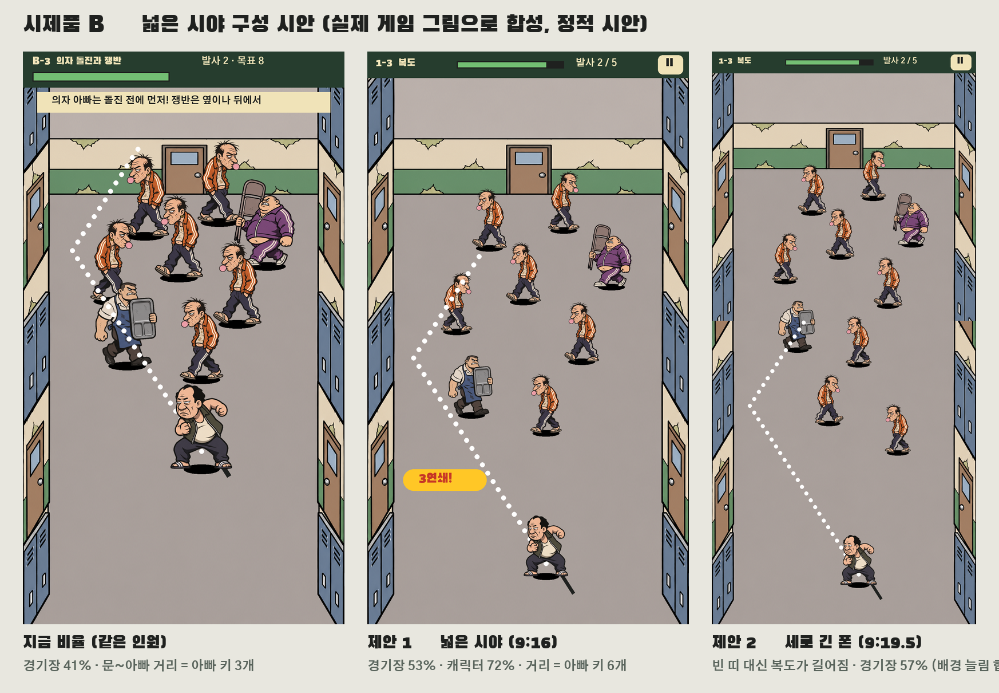

# 아빠 전쟁 — B안 전환 변경 요청서 v1 (넓은 시야 포함)

작성: 2026-11-04, PM. 핵심 조작이 "아빠를 당겨 쏘면 직접 날아가 튕긴다"로 바뀌었다(PM D-007, [시제품 B](dad-war-slingshot-v1.md)). 지금의 화면·성장·판 구성·문구는 대부분 자동 펀치를 전제로 만들어졌다. 이 문서는 B안이 처음부터 이런 게임이었던 것처럼 자연스러워지도록 바꿀 것을 담당별로 요청한다. 사용자 요청에 따라 "더 넓은 시야" 구성도 포함한다.

## 1. 자연스러움의 기준

1. **모든 성장은 "다음 한 발이 어떻게 달라지는가"로 보인다.** 강화·장비·특수 발사는 숫자보다 날아가는 방식으로 체감돼야 한다.
2. **화면 문구는 당겨 쏘기만 말한다.** 드래그 이동·자동 펀치·방향키 안내는 남기지 않는다.
3. **아빠는 평소 태연하고, 날아갈 때만 과장된다.** 서 있는 아빠는 무표정, 비행·벽 튕김은 크게.
4. **한 판은 몇 발로 정리하는 퍼즐과 다가오는 압박의 조합이다.** 반복 동기는 별(발사 수)과 연쇄 기록이다.
5. **한 화면에 하나만 크게 보인다.** 상대·조준선이 먼저 보이고, 글자와 효과는 짧게 지나간다.

## 2. 넓은 시야 구성

실제 게임 그림으로 합성한 정적 시안이다. 같은 인원(지호 아빠 6·의자 1·쟁반 1)을 지금 비율과 제안 비율로 배치했다.

| 항목 | 지금 시제품 | 제안 |
| --- | --- | --- |
| 캐릭터 크기 | 아빠 150 · 지호 아빠 140 · 보스 200 | **72%**: 108 · 100 · 144. 충돌 반경도 같은 비율 |
| 경기장 | 세로 240~760, 화면의 41% | 세로 240~910, **53%**. 하단 패널 없음 |
| 문에서 아빠까지 | 아빠 키 3개 | **아빠 키 6개**. 다가오는 모습이 보이는 시간이 생김 |
| 상단 표시 | 60px 두 줄 + 안내 띠 상주 | **44px 한 줄**(판 이름·체력·발사 수·일시정지). 안내는 첫 발 전에만 |
| 연쇄 표시 | 위 가운데 큰 배지가 상대를 가림 | 왼쪽 아래 작은 칩, 5연쇄 이상만 0.6초 크게 |
| 세로 긴 폰(9:19.5) | 위아래 약 15%가 빈 띠 | **복도가 세로로 길어짐**(경기장 57%). 버튼만 9:16 안전 영역 안에 |
| 벽 | 바닥과 사물함의 경계는 x 46·494에서 곧게 수직인데, 튕김 벽이 그보다 18px 안쪽이라 아빠가 사물함에 닿기 전에 튕김. 사물함 면은 원근으로 그려져 위쪽이 비스듬해 보임 | 튕김 벽을 그려진 바닥 경계에 맞춤(11/4 적용). 긴 복도 배경에서는 사물함 면을 더 곧게 |
| 배경 대비 | 바닥·사물함이 캐릭터만큼 진함 | 바닥·벽의 채도와 대비를 한 단계 낮춰 캐릭터·조준선이 먼저 보이게 |
| 흔들림·확대 | 작은 타격에도 흔들림 | 벽꿍·보스만 흔들림, 확대는 보스 마무리 0.25초만 |

캐릭터 한 명당 쓸 수 있는 화면은 약 2.5배가 된다. 줄어든 캐릭터 때문에 표정 개그가 덜 보이는 손해는 홈·결과·보스 등장 컷의 큰 얼굴로 보완한다. 조준은 "화면 아무 데나 당기기"라서, 캐릭터가 작아져도 터치하기 어려워지지 않는다.

## 3. 변경 요청

담당: **개발**(코드), **디자인**(원화·UI), **기획**(PM, 규칙·수치·문구). 우선: P0 = 11/18 사람 테스트(G1) 전, P1 = G1 통과 후 본 게임 이식 때, P2 = 1층 완성 전.

| ID | 영역 | 지금 | 요청 | 담당 | 우선 |
| --- | --- | --- | --- | --- | --- |
| C-01 | 시야 | 2절 "지금" | 2절 제안 1을 시제품 B에 적용하고 봇으로 압박을 다시 잰다. 걷기 속도보다 인원·등장 간격으로 맞춘다 — **11/4 적용**(메뉴에서 72%/80% 전환, 7절) | 개발 | P0 |
| C-02 | 벽 정렬 | 튕김 벽이 그려진 바닥 경계보다 18px 안쪽 | 튕김 벽을 바닥 경계(x 46·494, 위 258·아래 930)에 맞춤 — **11/4 적용** | 개발 | P0 |
| C-03 | 연쇄 표시 | 상대를 가림 | 2절대로 위치·크기 변경 — **11/4 적용** | 개발 | P0 |
| C-04 | 첫 10판 | 판 배치표가 자동 펀치 기준 | [first10 CSV](dad-war-first10-v2.csv)를 다시 쓴다. 1-1 당기기, 1-2 벽 튕김, 1-3 몸 연쇄, 1-4 의자, 1-7 쟁반 우회, 1-10 큰아빠. 별 기준은 발사 수 | 기획 | P0 |
| C-05 | 문구 | "드래그로 다가가세요 · 펀치는 자동!", "드래그 이동 · 가까우면 자동 펀치 / PC: 방향키", "① 드래그로 다가가면 아빠가 자동으로 펀치!" | 당겨 쏘기 문구로 교체. PC 안내는 모바일에서 숨김 | 기획·개발 | P1 |
| C-06 | 필살기 | "아빠 화났다!" 버튼을 충전 후 누름 | 버튼을 없앤다. 한 발에 5연쇄를 만들면 다음 한 발이 자동으로 **분노 발사**(관통·더 빠름)가 된다. v2의 연쇄 폭주와 통합 — **11/5 시제품 B 적용** | 기획·개발 | P1 |
| C-07 | 잔기술 | 레벨업 때 전투를 멈추는 카드 3장 | 제거. 판 안의 성장은 분노 발사 하나로 충분 | 개발 | P1 |
| C-08 | 강화 4종 | 주먹·체력·연타·날리기가 공통 전투력 | **들이받기**(맞힌 아빠 피해·밀어내는 힘), **체력**, **도움닫기**(최대 발사 속도), **멀리 날리기**(맞은 아빠의 비거리·벽꿍 피해)로 재정의. 아이콘은 기존 4종 재사용 | 기획 | P1 |
| C-09 | 장비 6부위 | 공통 전투력 % | 발사 성질로 바꾼다. 신발 = 튕긴 뒤 덜 느려짐, 손 = 들이받기 힘, 상의 = 체력·피격 뒤 무적 시간, 머리(안경) = 조준선이 두 번째 튕김까지, 소지품(폴더폰) = 판당 한 번 엄마 전화(다시 쏘기), 생활용품(효자손) = 벽꿍 피해 | 기획 | P1 |
| C-10 | 준비물 3종 | 고무 슬리퍼·튼튼한 도시락·폴더폰(장비 이름과 중복, PM R8) | **특수 발사 3종**으로 바꾼다. 벽꿍형 = 첫 벽 튕김 뒤 가속, 연쇄형 = 맞은 아빠가 더 멀리 날아감, 폭주형 = 분노 발사가 빨리 참 | 기획 | P1 |
| C-11 | 큰아빠 | 체력 28배·슈퍼 아머 | "무거워서 한 번에 안 날아감": 두 번 맞혀야 날아가고 몸이 1.3배. 체력 배수는 다시 맞춤 — **11/5 시제품 B 적용(3초 안 두 번, 체력 8)** | 기획 | P1 |
| C-12 | 결과 화면 | 최대 연쇄·벽꿍·제압 | **발사 수(목표)**·최대 연쇄·벽꿍. 별 3개 조건을 결과에 표시 | 개발 | P1 |
| C-13 | 홈 출발 카드 | 권장 전투력 | 목표 발사 수와 새 상대 아이콘. 전투력 숫자는 강화 화면으로 | 기획·디자인 | P2 |
| C-14 | 2·3층 규칙 | 급식 카트·반발 매트가 v2에 제안만 됨 | 급식 카트 = 맞히면 굴러가는 탄환(연쇄 매개). 반발 매트 = 튕기면 가속. 피구 아빠 = 공을 던지는 원거리, 날아가며 공을 맞히면 되돌려 보냄 — **피구 아빠만 11/5 시제품 B 적용** | 기획 | P2 |
| C-15 | 광고 3지점 | 장비 체험 = 특수 장비 1회 | 엄마 전화 부활·결과 추가 코인은 그대로, 장비 체험은 **특수 발사 1회 체험** | 기획 | P2 |
| C-16 | 경제 | 클리어 코인 고정 | 제압 수 + 연쇄 보너스 + 목표 이하 발사 보너스 | 기획 | P2 |
| C-17 | 오프닝 연결 | 6컷 뒤 바로 전투 | 1-1 시작 때 아빠가 복도 끝에 착지하는 1초 전환 | 디자인·개발 | P2 |

## 4. 에셋 요청

모든 캐릭터는 기존 규격(768 캔버스, 발 위치 384·720, 아빠는 오른쪽을 봄)을 따른다. 72%로 줄여도 기존 원화 해상도는 충분하다.

| ID | 에셋 | 규격·조건 | 쓰는 곳 | 우선 |
| --- | --- | --- | --- | --- |
| A-B01 | 긴 복도 배경(1층) | 1080×2340, 9:16은 위아래를 잘라 씀. 위에서 내려다보는 각도에 가까운 곧은 벽, 문은 위쪽 가운데, 사물함 구간 6~8개(문·창문 구간 구분), 바닥 대비 낮게, 인물·글자 없음 | 전투 전체 | P0 |
| A-B02 | 아빠 당기기 자세 | 몸을 뒤로 젖혀 웅크림, 무표정에 이마만 찌푸림 | 조준 중 | P0 |
| A-B03 | 아빠 비행 자세 2장 | 몸 수평·주먹 앞으로 / 슬리퍼가 벗겨질 듯 | 날아가는 동안(회전해서 씀) | P1 |
| A-B04 | 아빠 벽 튕김 자세 | 등이나 옆구리가 사물함에 닿는 순간 | 벽 튕김 | P1 |
| A-B05 | 아빠 착지 자세 | 무릎 굽혀 미끄러지며 멈춤, 다시 무표정 | 착지 | P1 |
| A-B06 | 비행 잔상·바람 선 | 투명 시트, V12 `impact-fx-v1`과 같은 선·색 | 비행 | P1 |
| A-B07 | 분노 발사 효과 | 아빠 몸 둘레의 불꽃 테두리, 투명 시트 | 분노 발사(C-06) | P1 |
| A-B08 | 손가락 당기기 안내 | 손 그림 1장(검지로 누르고 뒤로 당김) | 첫 발 안내 | P1 |
| A-B09 | 특수 발사 아이콘 3종 | 벽꿍형·연쇄형·폭주형, 256 아이콘 | 강화 탭·장비 체험 광고 | P1 |
| A-B10 | 큰아빠 무거움 표시 | 발밑 먼지·땀방울 | 큰아빠(C-11) | P2 |
| A-B11 | 급식 카트·반발 매트 | 카트 정상·굴러감, 매트 대기·튕김 | 2·3층(C-14) | P2 |
| A-B12 | 긴 복도 배경 2·3층 | A-B01과 같은 규격 | 급식실·체육관 — **11/5 P1로 올림**: 메인 게임 2·3층이 v5 그림(540×960)을 쓰고 있어 상대가 뒷벽 위에서 나타남 | P1 |
| A-B13 | 효과음 4종 | 고무줄 당기기(세기에 따라 음이 높아짐), 발사 휘익, 벽 튕김 "퉁", 착지 | 조준·비행 | P1 |
| A-B14 | 1-1 진입 전환 | 아빠가 복도 끝에 착지하는 그림 1장 | 오프닝 연결(C-17) | P2 |

**11/5 납품·적용:** A-B01~A-B09, A-B13이 [V13](../Assets/DadSchoolBoss/Art/V13Slingshot/README.md)으로 납품돼 시제품 B에 연결됐다([시제품 문서](dad-war-slingshot-v1.md) 4-1절). A-B10~A-B12, A-B14(P2)는 남아 있다.

## 5. 결정이 필요한 것

1. **시야:** 제안 1(9:16 넓은 시야)을 먼저 적용하고, 제안 2(긴 폰)는 긴 복도 배경(A-B01)이 오면 적용 — 추천.
2. **캐릭터 크기:** 72%와 80% 중 실기기에서 얼굴이 읽히는 쪽. 시제품에 둘 다 넣어 비교한다.
3. **필살기 버튼 제거**(C-06)와 **잔기술 제거**(C-07).
4. **강화·장비·준비물 재정의**(C-08~C-10). 동의하면 v2 6절을 이 기준으로 고친다.

## 6. G1(11/18)까지의 순서

1. ~~C-03 → C-01 → C-02: 시제품 B를 넓은 시야로 고치고 봇으로 다시 잰다.~~ 11/4 완료(7절).
2. C-04: 첫 10판을 시제품 B에 배치한다.
3. A-B01·A-B02를 디자인에 요청한다(배경이 늦으면 지금 배경으로 테스트).
4. G1 사람 테스트를 한다.
5. 통과하면 C-05~C-12로 본 게임에 이식한다.

## 7. 적용 기록 (11/4, 시제품 B)

- **경기장:** 복도 바닥 전체(x 46~494, y 258~930). 아빠는 아래 가운데(y 890)에서 시작한다.
- **캐릭터:** 기본 72%, 판 목록 아래 「캐릭터 크기」에서 80%로 바꿀 수 있다. 충돌 크기·근접 거리·발밑 간격도 같은 비율로 줄었다.
- **화면 배치:**
  - 상단 44px 한 줄(판 이름·체력·발사 수/목표·목록). 보스 체력 줄과 알림 띠는 그 아래에 필요할 때만 나온다.
  - 첫 발 안내는 상단 바 아래 뒷벽 위에 둔다(상대는 그 아래에서 등장).
  - 연쇄는 왼쪽 아래 칩으로, 5연쇄 이상만 가운데에 0.6초 크게 띄운다. 남은 인원은 오른쪽 아래 칩.
  - 화면 흔들림은 벽꿍·보스만.
- **보스:** 날아가는 보스가 작은 아빠와 부딪힐 때 속도를 85% 유지한다(전에는 45%). 넓어진 복도에서도 그로기 → 벽꿍이 벽까지 닿게 하기 위해서다.
- **검증:** 규칙 검사 22개 통과(넓은 시야 2개 추가)([dad-slingshot-checks.txt](dad-slingshot-checks.txt)).
- **자동 플레이 봇(초보 봇 기준, [dad-slingshot-bot.txt](dad-slingshot-bot.txt)):**

| 판 | 시간 | 남은 체력 | 결과 |
| --- | --- | --- | --- |
| B-1 | 9초 | — | — |
| B-2 | 15초 | 92 | — |
| B-3 | 28초 | 80 | — |
| 보스 | 45초 | 30 | 60판 중 11판 패배 |

  v2 기획의 목표 길이(일반 20~35초, 보스 40~60초)에 들어온다. 표적이 작아져 발사가 늘어서, 별 3개 목표 발사를 B-3 9번, 보스 15번으로 조정했다.

## 8. 메인 게임 이식 기록 (11/5, PM D-008)

G1 사람 테스트 전에 사용자 결정으로 본 게임에 먼저 이식했다. 자세한 수치는 [시제품 문서](dad-war-slingshot-v1.md) 4-2절, 화면은 [dad-war-main-slingshot-v1.png](dad-war-main-slingshot-v1.png).

| ID | 상태 |
| --- | --- |
| C-04 첫 10판 | 적용. 1-1~1-10을 당기기 → 튕김·연쇄 → 줄 선 무리 → 의자 → 몸풀기 → 쟁반 → 섞기 → 피구 → 큰아빠 순서로 배치(CSV는 아직 옛 기준) |
| C-05 문구 | 전투 안 문구는 슬링샷 기준. 홈 카드·강화 설명의 옛 문구는 남아 있음 |
| C-06 분노 발사 | 적용(전투 안). 메인 게임의 필살기 버튼은 슬링샷 전투에 나오지 않음 |
| C-07 잔기술 | 슬링샷 전투에는 레벨업 카드가 없음(옛 전투 코드에만 남음) |
| C-08 강화 4종 | 초안 수치로 연결(들이받기·체력·도움닫기·멀리 날리기). 강화 화면 이름·설명 교체는 남음 |
| C-09 장비 6부위 | 아직. 도시락 장비는 전투에 영향 없음 |
| C-10 준비물 3종 | 벽꿍형·연쇄형·폭주형 효과로 연결. 이름·아이콘 교체는 남음(R8) |
| C-11 큰아빠 | 적용. 층마다 다른 역할을 든 큰아빠(체력 8 → 10 → 12) |
| C-12 결과 화면 | 적용. 발사/목표·최대 연쇄·벽꿍, 별은 전투 기준으로 저장 |
| C-13~C-17 | 아직 |
