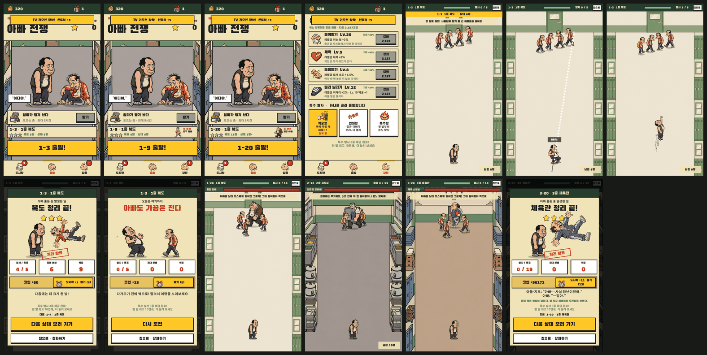

# 아빠 전쟁 — PM 운영 문서 (결정·일정·관문·위험)

작성: 2026-11-04, 게임사업 PM. 대상 브랜치: `codex/dad-war-design-v2`. 이 문서는 무엇을 언제 결정했고, 다음 2주에 무엇을 해서 어떤 기준으로 다음 단계를 여는지를 한곳에 둔다. 기획 내용 자체는 아래 기준 문서에 있다.

## 1. 기준 문서 지도

| 질문 | 기준 문서 | 비고 |
| --- | --- | --- |
| 이야기·인물·정책 표현 | [dad-war-plan.md](dad-war-plan.md) | 제목·대사·인물·성인 규칙 |
| 조작·경제·광고·검증 지표 | [dad-war-product-v2.md](dad-war-product-v2.md) | 11/4 채택. 수치는 플레이 관찰 전까지 가설 |
| 첫 10판·광고 지점·초깃값 | [dad-war-first10-v2.csv](dad-war-first10-v2.csv), [dad-war-ad-placements-v2.csv](dad-war-ad-placements-v2.csv), [dad-war-tuning-v2.json](dad-war-tuning-v2.json) | 게임이 아직 읽지 않는 제안 데이터 |
| 전체 단계·관문·필요 에셋 | [dad-war-roadmap.md](dad-war-roadmap.md) | 0~4단계, G1~G5, 단계별 에셋 |
| B안 전환 변경·넓은 시야 | [dad-war-b-changes-v1.md](dad-war-b-changes-v1.md) | 변경 요청 C-01~C-17, 에셋 요청 A-B01~A-B14 |
| 화면 디자인 진행 | [dad-war-design-roadmap-v1.md](dad-war-design-roadmap-v1.md) | 디자인 세션 작성(D0~D7), 전체 로드맵 단계에 배치 |
| 결정·2주 상세·위험 | 이 문서 | |

참고 기록(현재 기준 아님): v4 재기획, v5 구조·경제(광고 7지점·하루 15회), v9 UI 방향, v10 시나리오. 서로 다르면 위 표의 문서가 우선한다.

## 2. 결정 기록

| ID | 날짜 | 결정 | 근거·영향 |
| --- | --- | --- | --- |
| D-001 | 11/4 | 제품을 「아빠 전쟁」 하나로 고정한다. Second Fist(골목 액션)·체육관 타이쿤은 보관한다. | 3일 동안 정체성이 다섯 번 바뀜. `Assets/Alley`의 `AlleyCombat`은 공유 전투 시뮬레이션이라 코드는 유지하고 씬만 보관 |
| D-002 | 11/4 | 시스템·경제·광고의 기준을 v2로 한다. dad-war-plan.md는 이야기·인물만 맡는다. | plan의 "플레이 그대로", "광고는 v5", "큰아빠 28배", "남은 결정 없음"이 v2와 충돌 |
| D-003 | 11/4 | 손 떼기 강타는 지금의 2D 빌드에서 먼저 검증한다. 3D는 같은 기간에 외형만 시험하고 11/18에 진입 여부를 결정한다. | v2 A단계가 조작과 3D를 한 납품으로 묶어서, 실패 원인을 분리할 수 없음 |
| D-004 | 11/4 | 재미·유머 검증은 한국에서 먼저 한다. 개그는 글 없이도 통하게 만들고, 글로벌 확장은 잔존 데이터를 보고 정한다. | 단톡방·학부모회장·급식 봉사 같은 개그는 한국 맥락 의존 |
| D-005 | 11/4 | 앱 ID와 Unity 버전을 이번 주에 확정한다(아래 4절 제안). | Play에 한 번 올린 앱 ID는 바꿀 수 없음. 광고 SDK는 엔진 업그레이드 뒤에 붙임 |
| D-006 | 11/4 | v11 오프닝과 v9 UI를 런타임에 적용한다. | 아래 3절 |
| D-007 | 11/4 | 핵심 조작을 **B안: 아빠를 당겨 쏘면 직접 날아가 튕기고, 그동안 상대 아빠들이 다가오는 방식**으로 바꾼다. 자동 펀치·이동과 v2의 손 떼기 강타(A)는 대체 후보에서 내린다. 11/18 사람 테스트로 확정한다. | 이동하며 자동 펀치를 보는 구조로는 플레이어가 만든 장면이 없음(사용자 판단). 시제품·검증은 [dad-war-slingshot-v1.md](dad-war-slingshot-v1.md). D-003의 3D 외형 시험은 뒤로 미룸 |
| D-008 | 11/5 | **시제품 B를 메인 게임 전투로 가져온다.** 오프닝·홈 3탭·도시락·강화·저장·결과는 그대로 두고 전투만 슬링샷으로 바꾼다. 자동 펀치 전투는 코드에 남겨 비교·검사용으로만 쓴다(`DadSchoolPrototype.UseSlingshot`). | 사용자 결정("이걸 메인 게임으로 가져갑니다"). 기록은 아래 3-1절, 규칙·수치는 [dad-war-slingshot-v1.md](dad-war-slingshot-v1.md) 5절 |

## 3. 11/4 런타임 적용 기록

- **오프닝(v11):** 검은 화면 `Mandu Corporation` → 키아트 + 런타임 제목·「게임 시작」 → 첫 플레이면 6컷 시나리오(자막·진행 점·건너뛰기) → 1-1. 저장이 있으면 홈으로 가고, 타이틀에서 「이야기 다시 보기」를 제공한다. 원화는 `Resources/DadV11`(원본은 `Art/V11Opening`), 코드는 `DadOpening.cs`.
- **UI(v9 구조, 아빠 전쟁 문구):** 하단 3탭(도시락·출발·강화)으로 기존 장비 팝업을 대체했다.
  - 출발 탭: 태연한 아빠 + 사물함에 박힌 지호 아빠(기존 v6·v7 그림 재배치), 엄마 방치 보상 줄, 스테이지 카드, 출발 버튼.
  - 도시락 탭: 6슬롯, 큰 개봉 버튼, 등급 확률과 첫 도시락 규칙 표시.
  - 강화 탭: 4행에 실제 효과와 공통 비용, 출동 준비물.
  - 결과: 「복도 정리 끝!」, 처리 완료 도장, 기록 3칸, 확정 보상, 다음 행동.
  - 코드는 `DadHomeScreens.cs`.
- **새로 쓰는 아이콘:** `tab_lunchbox`·`tab_go`·`tab_upgrade`(탭), `btn_idle_chest`(방치 보상), `mom_cheer`(3패 응원 보정), `btn_awaken`·`mom_call`(필살기 버튼: 아빠 얼굴 / 폴더폰 준비물일 때 엄마 전화).
- **붙이지 않은 에셋:** `btn_attendance`(출석 기능 없음), `btn_free_lunchbox`·`btn_awaken`의 광고 용도·`sfx_revive`(v2에서 빠졌거나 광고 SDK 이전), `tab_shop`(초기 상점 없음), `tab_school`(지도 화면 없음), `distance`(쓸 화면 없음), `story/intro_1~3`(옛 도시락 배달 이야기, v11로 대체).
- **문구 조정:** 2컷 대사 "걔가 아빠를 데려왔어"를 홈 부제와 같은 "지호가 자기 아빠 데려왔대…"로 바꿨다. 옛 배달 설정의 잔재인 "계속 배달하기"·"첫 배달 성공"은 "계속 싸우기"·"첫 승리"로 바꿨다.
- **검증(Unity 2021.3.2f1 에디터):**
  - 에셋 검사에 v11 그림·import 규칙·v9 아이콘 3항목을 추가했다.
  - 플레이 검사에 오프닝 흐름 4항목을 추가했고 전체 32개가 통과했다.
  - 경제·스테이지·쟁반 검사 162개가 통과했다.
  - 화면 캡처 명령 `ui:<폴더>`(16장)를 추가했다.
  - 실기기·모바일 터치는 아직 확인하지 않았다.

## 3-1. 11/5 메인 게임 전투 교체 기록 (D-008)

- **흐름:** 홈 「출발」 → 슬링샷 전투 → 결과 카드(코인·도시락·별 저장) → 다음 판 또는 집으로. 전투 중 상단 「집으로」와 뒤로 가기는 홈으로 간다.
- **판 구성:** 3층 × 20판을 `SlingshotSim.ForMain`이 만든다. 1-1~1-10은 첫 10판 순서(당기기 → 튕김·연쇄 → 의자 → 몸풀기 판 → 쟁반 → 피구 → 큰아빠), 나머지는 판이 갈수록 상대 수·역할 비율·속도가 오르고 10번째 판은 큰아빠, 20번째 판은 그 층 보스다.
- **성장 연결(C-08 초안 수치):** 주먹 → 들이받기, 체력 → 체력, 연타 → 도움닫기, 날리기 → 멀리 날리기. 강화 탭도 같은 이름과 실제 효과(레벨당 수치, 지금 값, 상한에 닿으면 「최대」)로 바꿨다. 수치는 전투 코드와 같은 표를 읽는다.
- **준비물 연결(C-10 초안):** 기존 3종을 벽꿍형(벽꿍 피해 +1)·연쇄형(맞은 아빠 +15% 더 멀리)·폭주형(첫 발이 분노 발사)으로 연결하고, 강화 탭에서 「특수 발사」라는 이름과 V13 아이콘으로 보여 준다. 장비와 겹치던 옛 이름(고무 슬리퍼·튼튼한 도시락·폴더폰)은 없앴다(R8 해결).
- **홈 출발 카드(C-13):** 권장 전투력 대신 그 판의 최고 별, 목표 발사 수, 상대 수를 보여 주고, 처음 나오는 역할 아빠(1-4 의자·1-7 쟁반·1-9 피구)·큰아빠·층 보스는 오른쪽에 그림과 이름표를 붙인다. 홈 위쪽 「전투력」 숫자는 「모은 별 / 180」으로 바꿨다. 전투가 전투력이 아니라 강화 수치로 돌아가기 때문이다.
- **결과 카드(C-12):** 발사/목표·최대 연쇄·벽꿍, 별은 전투 규칙(클리어·체력 절반·목표 발사 수)을 그대로 저장한다.
- **2·3층 배경:** V13 긴 복도는 1층뿐이라 2·3층은 v5 급식실·체육관 그림을 쓴다. 뒤쪽 벽 위에서 상대가 나타나 보이므로 긴 배경 A-B12를 P1로 올린다. 사물함 찌그러짐도 1층에서만 그린다.
- **검증(Unity 2021.3.2f1 에디터):** 슬링샷 규칙 36개, 플레이 검사 45개(슬링샷 연결 14개 추가), 경제·스테이지 73개가 통과했다. 캡처 명령 `slingmain:<폴더>`(13장)를 추가했다. 초보 봇(시작 장비, 강화 없음)은 일반 판 95~100% 승리, 층 보스는 15/20·12/20·12/20([dad-slingshot-mainbot.txt](dad-slingshot-mainbot.txt)). 실기기 터치는 아직 확인하지 않았다.

## 4. 이번 주 확정할 것 (D-005)

| 항목 | 제안 | 이유 |
| --- | --- | --- |
| 앱 ID | `com.manducorporation.dadwar` | 회사 표기 Mandu Corporation과 일치. 현재 값은 `com.DefaultCompany.2DProject` |
| Unity | **Unity 6.3 LTS**로 별도 브랜치 업그레이드 | 2021.3은 지원 종료. plan 7절의 "2022.3 LTS 이상" 중 2022.3은 일반 지원이 2025년 5월 종료, 6.0 LTS는 2026년 10월 종료. 6.3 LTS는 2027년 12월까지 지원(Unity 공식 지원 페이지로 재확인) |
| Play 목표 API | API 36(Android 16) | 신규 앱·업데이트는 2026-08-31부터 API 36 이상 필요 |

업그레이드 완료 조건: 기존 에셋·플레이·경제 검사가 같은 결과로 통과하고, IMGUI 글꼴과 9:16 화면 배치에 변화가 없다.

## 5. 2주 계획과 관문 (11/5 목 ~ 11/18 수)

> 이전 A0·3D 시험 계획이 아래 표에 남아 있다. D-007/D-008 이후 이번 실행 기준은 [슬링샷 성장·재도전 적용 기록](dad-war-growth-replay-v1.md)과 [현재 첫 10판](dad-war-first10-slingshot-v3.csv)이다. 조작 관문은 손 떼기 강타가 아니라 당겨 쏘기/의도한 벽꿍으로 읽는다. 3D 시험은 보류한다.

| 주 | 작업 | 담당 | 완료 조건 |
| --- | --- | --- | --- |
| 1주 | 기준 문서 정리(이 문서, plan 범위, README) | PM | 문서끼리 충돌 없음 |
| 1주 | 앱 ID·Unity 버전 확정 | 사용자 | 4절 확정 |
| 1주 | Unity 6.3 LTS 업그레이드 브랜치 | 개발 | 4절 완료 조건 |
| 1주 | A0: 지금 2D 빌드에 손 떼기 강타(1-1~1-3) | 개발 | 게이지 4칸·방향 ±35°·허공 미소모가 v2 2.1절대로 동작 |
| 1주 | 디자인 D1 공통 토큰·D2 홈 | 디자인 세션 | 3절 화면 구조를 바꾸지 않고 색·컴포넌트만 교체 |
| 1주 | 테스트 참가자 20명 모집, 관찰 양식 | PM | 처음 해 보는 사람, 기록 양식 v2 12.1절 |
| 2주 | A0 확장: 1-1~1-10(첫 10판 CSV) | 개발 | 10판 모두 클리어 가능, 큰아빠 그로기 주기 동작 |
| 2주 | 3D 외형 시험: 아빠·지호 아빠·사물함·복도 1구역 | 아트 | 저사양 Android 30fps, 같은 장면 2D·3D 비교 영상 |
| 2주 | 20명 플레이 테스트 | PM | 아래 관문 표의 수치 기록 |
| 11/18 | 관문 회의 | 사용자·PM | 아래 세 가지 결정 |

**11/18 관문(v2 12.1절 기준, 20명 중):**

| 관찰 | 통과 | 실패 시 |
| --- | --- | --- |
| 3판 안에 손 떼기 강타를 의도해서 사용 | 16명 | 타깃 표시 수정 또는 대안 B(짧은 스와이프) 비교 |
| 직접 만든 벽꿍·연쇄를 설명 | 12명 | 적 배치·강타 경로 수정 |
| 권유 없이 추가 판 시작 | 12명 | 보상 전에 전투 반복 수정 |
| 첫 장비 전후 변화를 알아챔 | 14명 | 수치·모션·공간 비교 수정 |

결정할 것: ① 손 떼기 강타 채택 여부, ② 3D 진입 여부(외형 시험 + 제작 시간 추정 + 30fps), ③ v2 B단계(첫 10판 본제작) 착수 여부. 숫자는 내부 가설이고, 20명 결과는 방향 판단에만 쓴다.

## 6. 위험 목록

| ID | 위험 | 영향 | 대응 | 점검 |
| --- | --- | --- | --- | --- |
| R1 | 제품 방향이 다시 바뀜 | 작업 폐기, 문서 충돌 | D-001 고정. 방향 변경은 이 문서에 결정 행을 추가한 뒤 진행 | 매 결정 |
| R2 | 같은 작업 사본에서 여러 세션이 동시에 작업 | 서로의 변경을 덮어쓰거나 남의 변경까지 커밋 | 세션마다 별도 worktree·브랜치. 코드 파일 담당을 한 세션으로 지정 | 즉시 |
| R3 | 조작 변경과 3D 전환이 묶임 | 실패 원인 분리 불가 | D-003: 2D에서 조작 먼저 | 11/18 |
| R4 | 콘텐츠가 빨리 소진됨(60판 순수 플레이 30~40분) | 광고 수익이 쌓이는 D7 이후 잔존 부족 | 출시 전에 60판 이후의 반복 구조 결정(결말의 "옆 학교 도전장" 활용) | 1층 20판 완료 시 |
| R5 | Google Play가 "아동에게 어필"로 판정 | Families 정책 대상이 되면 광고 SDK 제한·개인화 광고 불가로 단가 하락 | 대상 연령 명시, 아이를 전투·광고·스토어 싸움 장면에서 제외(plan 6절 유지) | 스토어 등록 전 |
| R6 | 엔진·API 요건 | 출시·업데이트 불가 | 4절 업그레이드를 광고 SDK보다 먼저 | 1주차 |
| R7 | 도시락 유료 판매 시 확률 공시 의무 | 법적 제재 | 확률표와 실제 뽑기가 같은 데이터를 읽게 유지(도시락 탭이 이미 경제 데이터를 그대로 표시) | 유료 상품 기획 시 |
| R8 | 준비물 이름과 장비 이름 중복("고무 슬리퍼"·"폴더폰") | 플레이어 혼란 | **11/5 해결:** 준비물을 특수 발사 벽꿍형·연쇄형·폭주형으로 바꿈(D-008) | — |

## 7. 디자인 검토 (11/4, 37개 화면 캡처 기준)

열린 Unity에서 오프닝·홈 3탭·전투(1-1·2-4·3-7)·보스(1-20)·그로기·잔기술 선택·일시정지·도시락 개봉·결과·시간 초과를 캡처해 [디자인 로드맵](dad-war-design-roadmap-v1.md), V12 시안과 대조했다. 오프닝·홈 3탭·도시락·강화·결과는 이번에 정리됐다. 남은 것은 아래와 같다.

| 우선 | 화면 | 관찰 | 제안 | 로드맵 |
| --- | --- | --- | --- | --- |
| P0 | 손 떼기 강타 UI | 2주 계획 A0에 필요하지만 로드맵은 "미구현이라 그리지 않음"으로 제외 | 발밑 4칸 게이지, 준비 시 손·짧은 조준선 노랑, 대상 발밑 화살표, 허공일 때 게이지 보존 표시를 1주차에 시안으로 확정 | D3 추가 |
| P0 | 전투 HUD | 위 145·아래 163 패널이 화면의 약 32%를 차지. 모든 판에 "드래그 이동…PC: 방향키" 안내 상주. 노란 경험치 줄은 설명 없음 | V12 시안 02처럼 얇은 상단 표시 + 전체 화면 경기장. 안내는 1-1~1-3만. PC 안내는 모바일에서 숨김 | D3 |
| P0 | 세로 긴 폰(9:19.5) | 540×960을 비율 유지로 축소해서 위아래 약 15%가 빈 어두운 띠(코드 기준, 실기기 미확인) | 배경·상단 재화줄·하단 탭을 화면 끝까지 늘리고 조작 요소만 9:16 안전 영역에 둠 | D7을 앞당김 |
| P1 | 첫 조작 안내 | "드래그로 다가가세요" 글자만 있음 | 손가락 드래그 그림 안내. 강타 방식이 바뀌므로 A0와 같이 제작 | D3 |
| P1 | 잔기술 선택 | 전투를 멈추는 글자 카드 3장, 아이콘 없음. v2 루프에 없는 화면 | 유지 여부를 먼저 결정. 유지하면 아이콘·효과 위계, 빼면 연쇄 폭주로 통합 | 결정 필요 |
| P1 | 설정 | 소리·진동 조절, 이야기 다시 보기(홈), 버전 표시가 없음 | 홈 우상단 메뉴(V12 시안 01의 ☰)와 일시정지에 같은 설정 | D2 |
| P1 | 지도 | 지난 판 재도전·별 모으기 화면이 없음 | v2 9절대로 출발 카드에서 지도 열기(`tab_school` 아이콘 있음) | D2 |
| P1 | 작은 글자·겹침 | 도시락 슬롯 이름 13, 일부 설명 14~15. "모두 열기" 알림이 탭 제목을 덮음 | 로드맵 기준 본문 18·보조 16으로 올림. 알림은 재화줄 아래 | D1 |
| P2 | 보스 등장 | 노란 배너 글자뿐 | 보스 이름표와 전용 등장 자세를 1초 이내 컷으로 | D6 |
| P2 | 타격 효과 | 작은 글자 팝업 위주. V12 `impact-fx-v1` 시트 미연결 | 벽꿍·몸 충돌에 시트 연결, 기본 타격은 작게 유지 | D3·D6 |
| P2 | 층 클리어·결말 | 단톡방 알림이 결과 창 본문 글자. 결말 2컷 그림 없음 | 단톡방 알림 틀과 결말 컷([이야기 에셋 요청서](dad-war-story-asset-request.md)) | — |
| P2 | 공통 색·버튼 | 코드 색(종이 .94·.89·.72 등)이 V12 토큰(#F5EEDC 등)과 다름. 버튼 눌림 상태 없음 | 색 상수 5개를 토큰으로 교체하고 눌림 상태 추가 | D1 |
| P2 | 스토어 자산 | 아이콘 외에 피처 그래픽·세로 스크린숏·짧은 영상이 없음 | 아이를 싸움 장면에 넣지 않는 규칙(plan 6절)으로 제작. 소프트 런칭·광고 소재 시험에도 사용 | 신규 |

작업 방식: 디자인 세션이 홈·전투 HUD를 Unity에 적용할 계획이다. `DadHomeScreens.cs`·`DadSchoolPrototype.cs`를 그 세션 한 곳에서만 고치도록 정해야 충돌이 없다(R2).

## 8. 열린 질문(사용자)

1. 제작 인원: 혼자와 AI 에이전트인지, 개발·아트 담당이 따로 있는지
2. 목표 출시 시점, 마케팅(UA) 예산 범위
3. 4절 앱 ID·Unity 버전 확정
4. 2컷 대사 조정("지호가 자기 아빠 데려왔대…") 승인
5. R8 준비물 이름 정리 방향
6. 「아빠의 잔기술」 레벨업 카드 유지 여부(B안에는 레벨업 자체가 없음, 빼는 쪽으로 제안)
7. 아들 외형 기준 통일: v11 컷(크림 티셔츠)으로 맞출지, 요청서(올리브 후드)로 맞출지
8. ~~그림만 있고 쓰지 않는 피구 아빠를 3층 체육관 상대로 쓸지~~ → 11/5 1-9에서 처음 나오고 이후 모든 층에 섞이도록 적용(D-008)
9. 강화 4종·특수 발사 3종의 이름과 문구 승인(11/5 적용: 들이받기·체력·도움닫기·멀리 날리기 / 벽꿍형·연쇄형·폭주형, 수치는 초안)

## 후속 검토 제안 (2026-11-05, 확정 결정 아님)

[다음 개발 검토](dad-war-next-step-review-2026-11-05.md): 224abcf의 문서/코드 대조. 도시락 장비 전투 미연결, 상한 이후 강화 구매, 넉백 강화 중복, 별 재도전 동선, B안 전환 뒤 남은 구형 일정/교육 기준을 우선 검토한다. 장비 최소 연결과 Android 첫 10판 관찰을 다음 작업으로 제안하며, 기존 D-001~D-008 결정을 변경하지 않는다.

## 11/5 성장·재도전 보완

[적용 기록](dad-war-growth-replay-v1.md): 강화 상한 구매 차단, 6부위 장비 패시브 연결, 직접 피해/비거리 강화 분리, 같은 판 재도전·해금 판 목록·최소 발사 기록. 구현과 실제 검증 범위는 기록의 검사 항목을 따른다. Android/Play Mode 검수는 아직 완료가 아니다.

## 11/6 난이도·재대결 구현

[난이도·단톡방 재대결 v1](dad-war-difficulty-rematch-v1.md): 1-10 이후 일반판 발사 한도, 저연쇄 착지 회복, 별 3개 최초 보상, 클리어 판 재대결 3단계와 단계별 최초 보상. 일반판 패배 보정에 발사 여유를 연결했다. 봇 비교와 Unity 검사는 문서/보고서를 따르며 유저의 지속 플레이 효과는 사람 관찰 전까지 가설이다.

## 11/6 장착 외형 연결

[장비 외형 v14](dad-outfit-appearance-v14.md): 슬롯별 장갑·신발·머리·양손 소품과 상의 색상을 홈/도시락/메인 전투/결과에 반영. 상의는 기존 실루엣 활용. 원본/런타임/검수 상태는 납품 문서 참고.

### V15 안경 착용 보정
인벤토리 그림 대신 빈 렌즈 테두리를 사용하고 대기/전투 자세별 눈 위치를 보정했다. Unity 장비 검사 11개 통과. [기록](dad-eyewear-fit-v15.md).

### V17 전체 장비 외형 수정
상의 16개와 착용 모자 1개 제작, 장갑/신발 UV 및 교체 영역, 소품별 그립과 비율 수정. Unity 18종 단독·8포즈 3등급·반전 및 실제 UI 확인. 장비 14개+연결 50개+경제/에셋 73개 통과. [기록](dad-equipment-appearance-v17.md). Android 성능은 미검증.

### 2026-11-09 · V18 품질 개선 1차
공통 글자/카드/버튼, 층별 노드 지도, 상대 대응 안내, 발사별 성과와 충격선, 일시정지/설정/앱 복귀, 결과 문구/다음 판, 저장 백업 복구를 구현. Unity 검사 210개와 macOS 실제 플레이어 7개 통과. Android 환경/엔진/ARM64/API36 점검은 BLOCKED. [기록과 다음 관문](dad-commercial-quality-v18.md). 아직 출시 완료로 판정하지 않음.

### 2026-11-09 · V19 재개 / 화면 공유 배려
제목/버튼 잘림의 GUI 그룹 충돌 수정 상태를 확인하고 기존 정상 캡처의 필수 문구 3개를 오프라인 OCR로 재검증. 빌드 후 자동 Play 제거, Game view 자동 생성 제거, 프로젝트 AGENTS에 창 활성화 금지 기록. Mono만으로 수행하는 창 없는 규칙 검사 56개 통과. 이번에는 Unity/플레이어를 실행하지 않음. [기록](dad-title-and-background-verification-v19.md).
