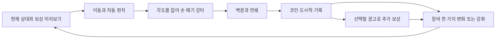

# 아빠 전쟁 — 재미·성장·광고 통합 기획 v2

작성: 2026-11-04. 기준 소스: codex/dad-school-boss, 71d14ab. 문서 상태: **제작을 위한 제안 초안**. 사용자가 요청한 대대적 재기획·광고 수익화·재미 우선·유사 3D 방향을 구체화한다. 이 문서를 작성한 것만으로 새 조작·수치·광고 SDK·3D 화면이 구현됐다는 뜻은 아니다.

이야기와 인물의 확정 사항은 [dad-war-plan.md](dad-war-plan.md)를 유지한다. 아래 조작·경제·광고 수치·화면 배치·개발 순서는 신규 제안이다. v5의 공통 전투력 성장, 20분 광고 버프, 광고 지점 7종은 비교 기준으로 남긴다. 다른 채팅에서 진행 중인 코드와 원화를 이 기획 작업에서 바꾸지 않는다.

## 1. 팔고 싶은 경험

**피곤한 아빠가, 내가 잡은 각도대로 상대 아빠들을 날려 학교를 핀볼판처럼 만드는 한 손 액션.**

플레이어가 기억할 것은 세 가지다.

1. 손을 떼자 앞의 아빠가 세 명을 들이받고 사물함에 박혔다.
2. 슬리퍼를 바꿨더니 날아가는 거리와 튕기는 방식이 달라졌다.
3. 큰아빠를 거의 잡았으니 한 번 더 해 보고 싶다.

| 항목 | 제안 |
| --- | --- |
| 장르 | 세로형 한 손 액션 + 장비 수집·성장 |
| 플랫폼 | Android 우선, Windows·macOS는 개발과 플레이 테스트 |
| 화면 | 고정 사선 카메라의 가벼운 3D, 단순한 형태·재질·그림자 |
| 한 판 | 일반 20~35초, 중간 보스 30~45초, 층 보스 40~60초를 목표로 측정 |
| 첫 세션 | 6~10분, 첫 장비 변화와 첫 중간 보스 경험 |
| 수익 | 선택형 보상 광고 3종, 검증 후 외형·전면 광고 제거 상품 검토 |
| 표현 | 확정된 성인 아빠 캐리커처, 생활용품, 만화식 충돌·별·찌그러짐 |

Supercent에서 참고할 것은 바로 이해되는 조작, 화면에 남는 보상, 가까이 보이는 다음 목표다. 식당 경영 흐름을 그대로 붙이지 않는다. 이번 게임의 주된 반복은 전투와 아빠 성장으로 통일한다. 체육관 운영을 별도 메인 모드로 추가하는 안은 이번 범위에 포함하지 않는다.

## 2. 기본 조작: 드래그 → 줄 세우기 → 손 떼기 강타

### 2.1 입력 규칙

| 입력·상태 | 동작 | 화면 피드백 |
| --- | --- | --- |
| 빈 바닥에서 드래그 | 아빠 이동, 가까운 적에게 자동 기본 펀치 | 이동 방향·발걸음, 작은 타격 반응 |
| 기본 펀치 명중 | 강타 게이지 +25, 최대 100 | 발밑 원형 게이지가 4칸으로 차오름 |
| 게이지 100 | 강타 준비, 이동은 계속 가능 | 손과 짧은 조준선에 노란 강조 |
| 드래그를 0.15초 이상 한 뒤 손을 뗌 | 마지막 이동 방향의 적에게 강타 | 즉시 발 고정 → 짧은 준비 → 큰 타격 |
| 방향 안에 가까운 적이 없음 | 멈추고 게이지 보존 | 허공 소비 없음 |
| UI 버튼 조작·터치 취소·앱 포커스 상실 | 강타 발동 없음 | 이동 입력 정리 |

탐색 후보는 마지막 이동 방향 기준 약 ±35도, 기본 펀치 거리의 약 1.2배 이내다. 후보가 있으면 준비 중에 발밑 화살표로 대상을 미리 표시한다. 출발점의 수치이며 손가락 이동과 실제 타격 방향의 일치도를 테스트한다. 화면을 가로지르는 긴 조준선은 쓰지 않는다.

초반 1-2 교육에서는 게이지를 미리 채워 벽꿍을 한 번 경험시킨다. 이후 네 번의 기본 명중으로 강타를 얻는다. 이동을 멈출 때마다 원하지 않는 강타가 나가는지 반드시 관찰한다. 입력 실수가 잦으면 대안 B인 짧은 스와이프 강타와 비교하고, 두 방식을 동시에 넣지는 않는다.

### 2.2 타격과 연쇄

- 기본 펀치: 작은 밀침. 적을 정렬하고 게이지를 채운다.
- 강타: 적 한 명을 이동 방향으로 크게 날린다. 벽 또는 다른 적을 맞히는 경로가 주된 판단이다.
- 적끼리 충돌: 날아간 적이 다음 적에게 힘을 전달한다. 동일한 두 적의 접촉은 냉각 시간 안에 중복 점수·피해를 만들지 않는다.
- 벽꿍: 피해와 큰 효과를 주고 해당 사물함의 찌그러짐 상태를 바꾼다. 변형은 그 판 동안 남는다.
- 연쇄 폭주: 5연쇄를 만들면 3초간 다음 강타가 빠르게 준비되고 비거리가 늘어난다. 광고 없이 얻는 전투 보상이다. 기존 수동 필살기를 이 흐름으로 통합하는 안이다.
- 마무리: 큰아빠·층 보스 처치에만 약 0.25초의 확대·짧은 슬로를 쓴다. 조작 불가 연출은 합계 0.6초 이내를 목표로 한다.

초기 상대값: 기본 피해 1, 강타 피해 2, 벽 충돌 추가 피해 2, 몸 충돌 피해 1. 일반 적은 기본 펀치 2~3번 또는 좋은 벽꿍 한 번으로 정리되는 범위에서 맞춘다. 실제 체력과 피해는 고정 스테이지 데이터로 작성하고 봇과 사람 플레이로 보정한다.

### 2.3 실력으로 달라져야 하는 것

정면에서 차례로 때리기보다 옆으로 돌아 여러 적을 한 줄로 만드는 편이 빠르다. 쟁반 뒤로 돌아가거나 돌진을 옆으로 피하면 좋은 발사 각도가 생긴다. 장비가 약해도 이 행동으로 클리어 시간을 줄일 수 있어야 한다.

핵심 통과 기준: 새 플레이어가 설명 없이 낸 우연한 연쇄와, 스스로 각도를 잡아 낸 연쇄를 구별해서 말할 수 있다. 주먹 네 번의 숫자 변화만으로 성장의 재미가 생겼다고 판정하지 않는다.

## 3. 적과 보스

| 역할 | 신호 | 대응과 보상 | 처음 소개 |
| --- | --- | --- | --- |
| 지호 아빠·접근형 | 두 손 들고 접근, 짧은 공격 준비 | 기본 강타와 벽꿍의 표적 | 1-1 |
| 서연이 아빠·의자 돌진 | 의자를 들고 고정된 바닥 화살표 | 옆으로 피하면 멈춘 적을 다른 적에게 발사 | 1-4 |
| 민준이 아빠·쟁반 방어 | 정면 쟁반, 뒤쪽은 열림 | 뒤로 돌거나 다른 적을 날려 방어를 흐트러뜨림 | 1-7 |
| 큰아빠·중간 보스 | 더 큰 몸, 느리고 명확한 준비 | 돌진 후 빈틈에 벽꿍, 일반 적보다 연쇄의 시작점으로 유리 | 1-10 |
| 층 보스 | 전용 등장 자세, 두 가지 공격 | 졸개를 날려 맞히면 그로기 → 보스를 벽으로 발사 | 1-20 |

최대 동시 돌진 1명, 동시 근접 준비 2명으로 시작한다. 등장 문·화면 바깥에서 걸어오고, 등장 0.4초간 공격하지 않는다. 위험 표시가 UI·손가락에 가려지는 위치에서 공격을 시작하지 않는다.

큰아빠의 체력을 일반 적의 28배로 고정하지 않는다. 새 비거리·피해·전투 시간 기준으로 다시 맞춘다. 보스는 체력을 늘리는 것과 별개로 공격→빈틈→그로기라는 읽을 수 있는 주기를 가진다.

보스 그로기 초기안: 날아온 졸개에 맞으면 약 2.5초. 준비 신호는 0.7~1초. 일반 펀치도 피해를 주되 방어 중에는 감소한다. 그로기 없이 시간을 오래 버티기만 해서 승리하는 흐름과, 그로기가 지나치게 어려워 아무것도 못 하는 흐름을 모두 점검한다.

## 4. 한 판과 세션의 반복

- 5초: 다음 강타, 지금 보이는 적 무리.
- 30초: 다음 스테이지와 기록 갱신.
- 5분: 새 장비 효과, 큰아빠.
- 다음 접속: 정해진 상한의 방치 보상, 다음 층의 다른 싸움 규칙.

결과에서 기본 보상은 즉시 확정한다. 다음 스테이지 버튼이 바로 보인다. 장비가 없거나 바꿀 것이 없으면 성장 화면에 들를 필요가 없다. 한 판마다 홈·강화·장비·결과 네 화면을 모두 통과시키지 않는다.

## 5. 첫 10스테이지와 첫 10분

세부 데이터는 [dad-war-first10-v2.csv](dad-war-first10-v2.csv)에 둔다. 예상 누적 시간은 중간 실패와 장비 선택을 포함한 가설이며 강제 대기 시간이 아니다.

| 시점 | 새 경험 | 다음 행동 |
| --- | --- | --- |
| 0~20초 | 건너뛸 수 있는 짧은 장난 도입, 아빠 출동 | 첫 상대에게 이동 |
| 1분 이내 | 일반 펀치, 교육용 게이지로 첫 벽꿍 | 두 번째 판 |
| 1~2분 | 직접 각도 잡아 연쇄, 첫 도시락 | 새 장비 전후를 바로 비교 |
| 2~4분 | 돌진 회피, 쉬운 장비 선택, 짧은 중간 도전 | 다른 각도 시도 |
| 4~6분 | 쉬운 압도 구간 뒤 쟁반 상대 | 뒤로 돌거나 적을 발사 |
| 6~10분 | 큰아빠, 결과·부활·체험 중 적합한 광고 제안 | 선택 후 즉시 다음 플레이 |

광고 제안은 **1-8 클리어와 누적 실제 플레이 6분을 모두 만족한 뒤** 해금한다. 빠른 플레이어에게 광고를 보여 주기 위해 기다리게 하지 않는다. 게스트 저장, 전투, 기본 장비 획득은 광고 없이 진행된다.

홈은 1-3 후 열고, 그 전에는 결과에서 바로 다음 판으로 간다. 강화는 첫 판 후 한 번만 짧게 보여 준다. 첫 도시락은 1-3 후, 두 번째는 1-5 후 지급한다. 스테이지 1~10에서 메뉴 안내는 신규 기능마다 한 번씩만 한다.

프롤로그는 기존 확정 이야기와 아들·아빠 반응을 유지한다. 6컷 원화가 있다고 6컷을 전부 길게 보여 줄 필요는 없다. 전체 10~15초 시안을 먼저 시험하고, 첫 접속에만 재생하며 건너뛰기를 제공한다. 새 컷과 3D 인물의 얼굴·의상 기준을 공유한다.

## 6. 성장: 숫자와 실제 변화의 연결

### 6.1 강화 4종

| 강화 | 실제 변화의 초기안 | 제한·비교 기준 |
| --- | --- | --- |
| 주먹 | 단계당 실제 기본·강타 피해 약 +8% | 1→2단계에서 필요한 명중 수가 줄어드는 교육 상대 제공 |
| 체력 | 단계당 실제 최대 체력 +10% | 공격력이나 적 피해를 공통 전투력으로 함께 바꾸지 않음 |
| 연타 | 단계당 자동 공격 간격 약 -2.5% | 속도 하한 약 기본의 70%, 강타 준비도 빨라지는 효과 |
| 날리기 | 단계당 발사 속도 +4% | 예측 경로·비거리 변화, 상한을 두어 화면 밖 폭주 방지 |

각 항목의 레벨과 비용은 독립적이다. v5의 모든 강화 합계가 같은 전투력을 올리는 방식을 대체하는 제안이다. 장비나 강화로 오른 능력은 고정 적에게 직접 적용한다. 전투 시작 시 현재 플레이어 전투력에 맞춰 적 체력을 다시 정하지 않는다.

초기 비용안: 주먹·체력 40코인, 연타·날리기 50코인, 항목별 구매 때마다 약 1.18배. 다음 값은 10코인 단위로 표시한다. 첫 주먹 강화는 첫 판 보상 안에서 구입 가능하다. 실제 강화 빈도는 첫 10판당 4~6회부터 검증한다.

권장 전투력은 참고값이고 예상 성공률을 확정하는 숫자로 쓰지 않는다. 출발 카드에 상대 역할과 공략 힌트를 함께 보여 준다. 강화 화면은 현재→다음의 실제 피해·체력·간격·비거리를 표시한다.

### 6.2 도시락 장비

6부위·기존 생활용품은 유지한다. 초기 등급은 현재 있는 일반·희귀·최고 3개다. 부위별 빈칸부터 채우고 첫 장비는 희귀 확정이다. 등급 확률은 초기 비교값 70/25/5를 공개하되, 실제 첫 획득 보정도 별도로 설명한다.

| 부위 | 예시 | 주된 변화 |
| --- | --- | --- |
| 손 | 장갑 | 강타 피해·충돌 전달 |
| 신발 | 슬리퍼 | 이동·발사 거리 |
| 상의 | 런닝셔츠·조끼 | 실제 체력·받는 밀침 |
| 머리 | 안경 | 목표 선택 편의 또는 조건부 피해 |
| 소지품 | 폴더폰 | 폭주 시간·조건 |
| 생활용품 | 효자손 | 벽꿍·튕김의 고유 효과 |

첫 도시락: 강타 비거리 +25%가 보장되는 장갑. 두 번째: 쟁반 뒤로 돌기 쉬워지는 슬리퍼. 세 번째: 벽 튕김 또는 충돌 전달 효과 중 하나를 고르는 생활용품. 초기 3개는 효과를 보여 주는 수작업 교육 보상이며, 이후부터 무작위 뽑기로 전환한다. 첫 희귀 확정과 교육 보상 규칙을 확률표에 함께 알린다. 등급이 높더라도 현재 능력과 다른 효과를 원할 수 있으므로 단순 초록 화살표가 선택을 대신하지 않는다.

초기 장비 조합은 3개만 만든다.

- 벽꿍형: 벽 충돌 피해·추가 튕김. 좁은 복도에 유리.
- 연쇄형: 몸 충돌 때 속도 전달. 다수 상대에 유리.
- 폭주형: 연쇄 폭주가 빨리 오고 길어진다. 타이밍을 이용하는 조합.

최고 등급은 같은 기본 수치의 큰 배율만 주는 대신 특성 한 개를 강화한다. 초반 장비는 전투력 +1처럼 보이지 않는 효과에 머물지 않는다. 새 장비를 장착한 다음 판에서 플레이어가 변화를 설명할 수 있어야 한다.

열기→짧은 카드→현재와 비교→장착/분해. 개봉 연출은 0.6초 이내, 언제든 넘길 수 있다. 정리 보조는 빈칸이 채워진 뒤 열며 자동으로 중요한 특성을 버리지 않도록 잠금을 둔다. 확률표·전체 아이템 목록은 별도 명세와 실제 코드가 같은 데이터를 읽게 한다.

### 6.3 코인·재도전·방치

- 초기 재화는 코인과 도시락 두 가지다. 에너지 소비 없이 재도전한다.
- 첫 클리어 보상은 첫 10판 CSV를 기준으로 한다. 같은 판 반복 코인은 기본의 50%, 실패 코인은 해당 판 기본의 30%를 진행률만큼 지급하는 초기안이다. 시작 즉시 패배를 반복하는 방식으로 보상을 받을 수 없게 최소 참여 조건을 둔다.
- 실패한 판의 장비나 재화를 잃지 않는다. 보스 HP를 다음 시도에 그대로 이어 두지는 않는다.
- 방치 보상은 기존 8시간 상한을 유지하되, 시간당 최근 클리어 판 기본 코인 2회분과 도시락 1개부터 시험한다. 복귀 보상 수령에 광고는 필요 없다.
- 첫 3패 이후 해당 스테이지에서 피해 저항 +5%씩, 최대 +20%의 응원 보정을 제공한다. 사용 중임을 표시하고 클리어 후 해제한다. 첫 시도나 광고 시청 여부로 난이도를 몰래 바꾸지 않는다.

방치 수입·반복 코인·광고 코인이 합쳐져 강화 한 번의 의미를 없애지 않는지 1일·3일·7일 경로를 다시 시뮬레이션한다. 기존 진행 시뮬레이션의 고정 시간·가상 승률 결과를 새 경제의 검증 결과로 재사용하지 않는다.

## 7. 콘텐츠: 60개의 번호보다 서로 다른 상황

출시 후보는 기존 3층 × 20판이다. 제작·재미 검증은 먼저 1층 10판을 완성하고 20판으로 확장한다.

| 층 | 고유 공간 규칙 | 주요 판단 | 층 보스 |
| --- | --- | --- | --- |
| 복도 | 사물함·짧은 벽 구간 | 적을 세워 벽꿍·연쇄 | 학부모회장 아빠 |
| 급식실 | 쟁반, 이동 가능한 빈 급식 카트 | 정면을 피하고 카트를 발사 경로에 이용 | 급식 봉사 반장 |
| 체육관 | 반발 매트·긴 공간 | 튕김 각도·멀리 있는 적 연결 | 체육 선생님 |

10번째는 큰아빠, 20번째는 층 보스다. 배경 교체만으로 다음 층을 만들지 않는다. 한 번에 소개할 신규 규칙은 한 개이며, 처음에는 안전하게 체험하고 다음 판에서 다른 역할과 섞는다.

반복 동기는 별 3개와 기록이다. 별은 클리어·체력 50% 이상·해당 판 고유 연쇄 목표로 구성한다. 연쇄 목표는 모든 판 동일한 5연쇄로 복사하지 않는다. 별 보상 상자는 정해진 수량의 코인·도시락이며 광고 없이 받는다.

## 8. 유사 3D·아트·모션

고정 사선 카메라, 원근감이 약한 3D 캐릭터와 시설을 제안한다. 360도 회전과 실제 가림·접지를 사용한다. 기존 아빠의 넓은 이마·피곤한 눈·배·조끼·슬리퍼, 상대의 쟁반·의자는 모델 실루엣 기준으로 보존한다.

- 한 가지 캐릭터 비율과 공통 리그를 쓴다. 아빠·상대·소품의 명암·외곽선 기준을 같은 장면에서 맞춘다.
- 저해상도 텍스처 또는 단색 재질, 제한된 광원과 간단한 그림자로 시작한다. 성능은 실제 목표 Android 기기에서 측정한다.
- 카메라 각도와 게임 속도는 실제 손가락 가림을 보며 확정한다. 배경에 강한 원근을 그리고 캐릭터만 다른 투영으로 올리지 않는다.
- 준비·명중·반동, 방향 전환, 출발·정지, 낙하·착지를 연결한다. 달리는 다리의 보폭을 실제 이동 거리와 맞춘다.
- 날아가는 동안 이동 방향·몸 회전·착지 그림자가 연결돼야 한다. 벽꿍은 벽 법선과 몸의 등·옆구리 방향을 맞춘다.
- 사물함은 정상→눌림→파손 3상태와 짧은 스프링 반응을 쓴다. 파편 수명·수량을 제한하고 재사용한다.
- 저사양 목표는 30fps 안정 유지, 중간급은 60fps다. 프레임 저하 시 파편·그림자를 먼저 낮추며 입력·충돌 주기는 유지한다. 이 수치는 성능 달성 주장이 아니라 검증 목표다.

최초 3D 제작 범위는 아빠 1명, 지호 아빠 1명, 사물함 1종, 복도 한 구역이다. 여기서 움직임과 타격의 일관성을 확인한 뒤 다른 적을 만든다. 새 캐릭터 원화를 계속 늘리는 일을 모션 검증의 대체로 삼지 않는다.

## 9. 화면과 소리

| 화면 | 먼저 보여 줄 것 | 주요 행동 |
| --- | --- | --- |
| 홈 | 아빠와 현재 장비, 다음 상대, 코인·도시락 | 출발 |
| 전투 | 적, 조준 후보, 벽, 내 체력, 강타 준비 | 이동·손 떼기 |
| 결과 | 연쇄와 마무리 장면, 확정 기본 보상 | 다음 / 선택형 추가 코인 |
| 장비 | 현재와 신규의 실제 효과 차이 | 장착 / 분해 |
| 강화 | 효과별 현재→다음·비용 | 한 단계 강화 |
| 지도 | 현재판, 큰아빠·층 보스 | 열린 판 선택 |

초기 탐색은 출발·도시락·강화 3개를 중심으로 구성한다. 지도는 출발 카드에서 연다. 초기 상점은 추가하지 않는다. 큰 제목체는 로고·짧은 강조에만, 수치·가격·설명은 읽기 쉬운 본문체를 쓴다. 터치 영역과 화면 잘림은 기기별로 검증한다.

소리의 우선순위는 작은 기본 타격 < 몸 충돌 < 벽꿍 < 보스 마무리다. 연쇄마다 피치를 조금 올리고 동시 소리 수를 제한한다. 기본 공격 때마다 큰 흔들림과 큰 글자를 넣지 않는다. 대사는 짧은 성격 표현으로 사용하고, 음성 없이도 상황과 플레이가 이해돼야 한다.

## 10. 광고: 재미가 생긴 뒤 보상을 선택하게 한다

초기 광고 지점은 다음 3개다. 자세한 조건은 [dad-war-ad-placements-v2.csv](dad-war-ad-placements-v2.csv).

| 지점 | 사용자가 얻는 것 | 기본 제한 |
| --- | --- | --- |
| 결과 | 이번 판 기본 코인과 같은 양의 추가 코인 | 하루 4회 |
| 패배 | 같은 판에서 체력 50%로 한 번 부활, 2초 안전 시간 | 판당 1회·하루 2회 |
| 출발 | 다음 전투 1회에 벽꿍·연쇄·폭주 특수 장비 중 1종 체험 | 하루 2회 |

전체 하루 상한 8회다. 이는 매출 예측이나 사용자 목표 시청 횟수가 아니라 첫 실험의 노출 제한이다. 전투 시작 준비→전투→결과를 하나의 사이클로 보고 최대 광고 1회만 허용한다. 출발 체험을 골랐다면 그 판의 부활·결과 광고는 제안하지 않는다. 이 규칙과 위치별 제한을 함께 적용한다. 날짜 경계는 기기의 현지 날짜로 정의하고 마지막 리셋 시각을 기록한다. 시계가 뒤로 바뀌었을 때 같은 날짜의 한도를 다시 지급하지 않는다. 부정 사용 방지는 서버 도입 시 별도로 강화한다.

### 10.1 결과 추가 코인

`기본 보상 100코인 확정` 아래에 `광고 보고 +100코인`과 `다음 스테이지`를 같은 시각적 위계로 둔다. 별 보상·첫 클리어 도시락·퀘스트 보상·이미 적용된 추가 코인은 배수 계산에서 제외한다. 보스 첫 보상 묶음 전체를 무제한 두 배로 만들지 않는다.

### 10.2 엄마 전화 찬스

실패 확정 후 전투를 멈추고 제안한다. 강제 카운트다운 없이 `광고 보고 체력 50%로 계속` / `결과 보기`를 제공한다. 보스 HP가 30% 이하라면 실제 남은 수치를 강조하고, 매번 가짜로 아깝게 보이게 만들지 않는다. 같은 전투 상태·남은 시간으로 복귀하며 전투 중 흐른 광고 시간은 타이머에 포함하지 않는다. 보상이 확정되면 소비된 부활 상태도 함께 저장한다.

### 10.3 전투 1회 장비 체험

첫 큰아빠를 한 번 경험한 뒤 기능을 공개한다. 세 특수 효과의 영구 획득 경로는 기본 플레이에도 둔다. 무료 도시락과 별 보상으로 같은 효과를 모을 수 있다. 체험 장비는 기본 장비를 덮어쓰지 않는 별도 슬롯이고, 전투가 끝나면 회수한다. 체험 종료로 기본 공격이나 이미 해금한 기술이 사라지지 않는다.

### 10.4 광고가 없어도 진행되는 경로

무광고 플레이도 코인 강화·도시락·별 보상·응원 보정으로 모든 출시 스테이지를 깰 수 있어야 한다. 광고 시청 여부로 적 체력·장비 확률을 바꾸지 않는다. 광고를 거절해도 다음 판·다시 도전이 즉시 가능하다.

전면 광고는 첫 재미·보상형 실험에서 기본 비활성으로 둔다. 재방문에 문제가 없을 때 별도 실험군에서만 결과를 닫는 자연스러운 전환에 시험한다. 후보 조건은 첫날과 첫 10분 제외, 3회 이상 클리어 및 직전 광고 이후 180초 경과, 하루 3회 이하, 보상형 직후 제외다. 결과 두 번 확인이나 앱 복귀를 핑계로 반복 노출하지 않는다. 전투·실패 직후·장비 선택 도중에는 넣지 않는다.

### 10.5 구현 계약

Google의 보상형 광고 정책은 사전 보상 설명과 명확한 사용자 선택을 요구한다.[1] 광고 표시 가능 여부를 확인하고 보상 콜백을 받아 지급하는 흐름은 Unity 공식 가이드에 따른다.[2] 개발·검수에는 테스트 광고를 쓴다.[2]

- 버튼을 눌렀을 때 지급하지 않는다. 광고가 닫혔다는 이유만으로 지급하지 않는다. 보상을 획득했다는 SDK 콜백으로 지급한다.
- 요청 ID·판 ID·지점·보상 값·지급 상태를 기록해 중복 콜백에도 한 번만 지급한다. 광고 전 기본 보상은 따로 저장한다.
- 준비 실패·노필·표시 실패 시 광고 실패를 알리고 기본 플레이로 돌아간다. 기다리라는 모달을 반복하지 않는다. 기본 보상은 유지한다.
- 획득 콜백 이후 앱이 종료돼도 미지급 보상을 복구한다. 결과 창을 다시 열어 추가 코인을 재지급하지 않는다.
- 일일 상한은 성공적으로 획득한 보상 수 기준이다. 한도 도달 버튼은 남은 횟수를 정확히 표시한다.
- 테스트용 즉시 보상과 실제 광고를 구분한다. 배포 화면에 시청하지 않은 광고를 시청했다고 표시하지 않는다.

상세 개인정보·광고 SDK 동의·스토어 요건은 실제 출시 국가·대상 연령·선택 SDK에 맞춰 출시 점검 때 확인한다. 이 문서는 광고 계정 생성·실제 광고 단위 연결·출시 심사가 끝났다는 의미가 아니다.

## 11. 상업성 판단

첫 목표는 광고 클릭 수가 아니라 **광고를 안 본 사람도 다음 판을 시작하는가**다. 광고를 본 뒤 게임으로 돌아와 계속 플레이하는지도 따로 본다.

일일 광고 매출은 대략 `광고 노출 수 × 해당 국가·형식의 실측 eCPM / 1000`으로 계산한다. 노출 수는 성공한 보상 광고와 전면 광고를 각각 센다. SDK 보상 획득 건수와 유료 광고 노출 건수는 다른 지표다. ARPDAU와 유지율을 함께 보고, 유저 획득 비용과 누적 수익을 같은 기간·국가·유입 경로로 비교한다. 현재 다운로드 규모·eCPM·수익은 가정하지 않는다.

외형 상품은 첫 비교 실험 이후에 검토한다. 전면 광고 제거 상품을 만들 경우 제거되는 광고와 남는 선택형 광고를 명확히 설명한다. 승리에 필요한 성능을 결제로만 판매하는 구조는 초기안에 넣지 않는다.

## 12. 검증과 의사결정

### 12.1 제작용 첫 관문: 새 플레이어 20명

아래 숫자는 내부 가설이며 업계 기준·실제 성과가 아니다. 작은 표본이므로 방향 판단에만 쓰고 결과의 인원수도 함께 기록한다.

| 관찰 | 임시 통과 기준 | 실패 시 조치 |
| --- | --- | --- |
| 입력 이해 | 20명 중 16명이 3판 안에 손 떼기 강타를 의도적으로 사용 | 조작·타깃 표시 수정 |
| 핵심 손맛 | 20명 중 12명이 직접 만든 벽꿍·연쇄를 설명 | 적 배치·강타 경로 수정 |
| 자발적 반복 | 20명 중 12명이 진행자 권유 없이 추가 판 시작 | 보상 이전에 전투 반복 수정 |
| 장비 변화 | 20명 중 14명이 첫 장비 전후 변화 식별 | 수치·모션·공간 비교 수정 |
| 광고 후 복귀 | 테스트 광고를 택한 사람의 실제 다음 행동 기록 | 보상·복귀 위치 수정 |

광고 보상 없이 플레이하는 군과 선택형 광고를 제공하는 군을 나눠 관찰한다. 테스트 참여 보상은 게임 광고 선택에 연동하지 않는다.

### 12.2 제한 배포

신규 사용자 수백 명 규모부터 첫 전투 완료·첫 강화·첫 장비·첫 실패 후 재도전·1-10 도달·다음 날 재방문을 관찰한다. 유입과 기기를 나누고, D1은 설치 다음 현지 날짜의 재방문처럼 집계 정의를 먼저 고정한다. 광고 실험은 고정된 배정으로 진행하고 전투 난이도까지 함께 바꾸지 않는다.

초기 확장 판단은 무광고 군의 유지율과 자발적 반복이 개선된 뒤 한다. 사전에 실험 기간·표본·허용 손실을 정한다. 초깃값은 광고군의 첫 실패 후 재도전율이 대조군보다 5%p 이상 낮아지거나 D1이 3%p 이상 낮아지면 원인을 검토하는 것이다. 이 차이는 작은 표본에서 확정적인 인과로 읽지 않고 구간 추정과 함께 본다. 광고군의 매출이 늘어도 재방문과 다음 판 진입이 크게 떨어지면 보상·빈도를 줄여 다시 시험한다. 시뮬레이션 통과를 사람의 재미나 광고 매출 검증으로 보고하지 않는다.

### 12.3 최소 이벤트

session_start, stage_start, stage_end, charged_punch, wall_hit, chain_end, upgrade_buy, gear_reveal, gear_equip, reward_offer, ad_request, ad_impression, ad_reward, ad_fail, next_stage_click.

공통 필드: 익명 설치 ID, 버전, 실험군, 이벤트 ID, 세션 ID, 판 ID, 스테이지, 시각. 전투 이벤트는 피해·선택 빌드·클리어 시간·원인으로, 광고는 지점·광고 요청 ID·실패 코드·확정 보상으로 집계한다. 자유 입력 개인정보는 수집하지 않는다. 이벤트 전송 재시도는 이벤트 ID로 중복 제거한다.

## 13. 제작 순서와 완료 조건

| 단계 | 납품 | 다음 단계로 넘어가는 조건 |
| --- | --- | --- |
| A. 조작과 3D 한 장면 | 아빠·지호 아빠·복도·사물함, 기본 펀치·강타·벽꿍 | 타깃 방향·접지·충돌이 일치, 20명 조작 관찰 |
| B. 첫 10판 | 서로 다른 배치, 돌진·쟁반·큰아빠, 결과→다음 | 첫 10판 반복·장비 변화 기준 통과 |
| C. 성장·저장 | 독립 강화 4종, 6부위·3등급·3조합, 복구 | 강제 종료 후 재화·장비·진행 중복·유실 없음 |
| D. 보상 광고 | 테스트 SDK, 3지점, 한도·콜백·오류·복구 | 테스트 광고 실제 표시와 정확한 보상 확인 |
| E. 1층 20판·실기기 | 층 보스·사운드·튜토리얼·가독성 | 목표 기기 성능, 장시간 오류·충돌 확인 |
| F. 3층과 제한 배포 | 층별 공간 규칙, 집계·실험, 실제 광고 설정 | 관찰 데이터로 확장 판단 |

광고 오류·중복 보상·저장·물리·보스 상태는 자동 검사한다. 조작 이해·손맛·유머·재도전은 사람 플레이로 판단한다. 구현 시작 전, 다른 채팅의 최신 변경을 확인하고 별도 브랜치에서 단계별로 합친다.

## 14. 이 문서가 바꾸는 우선순위

1. 핵심 조작과 3D 장면의 일관성을 먼저 만든다.
2. 첫 장비와 독립 강화의 실제 효과를 만든다.
3. 첫 10판에서 반복할 이유를 확인한다.
4. 세 지점의 광고를 실제 테스트 SDK로 검증한다.
5. 60판·상점·장비 등급 확장은 플레이 관찰 이후 진행한다.

유머 있는 이야기와 아빠 디자인은 유지한다. 신규 시스템을 늘리는 것보다, 플레이어가 각도를 잡은 결과와 보상으로 달라진 다음 판을 선명하게 만든다.

## 출처와 기준 문서

[1] Google AdMob, [Policies for ad units that offer rewards](https://support.google.com/admob/answer/7313578?hl=en), 2026-11-04 확인. 보상 설명·사용자 선택 관련 근거.

[2] Google for Developers, [Rewarded ads — Unity](https://developers.google.com/admob/unity/rewarded), 2026-11-04 확인. 테스트 광고·표시 가능 확인·보상 콜백 관련 근거.

[3] Google AdMob, [Best Practices for In-App Rewarded Video Ads](https://admob.google.com/home/resources/best-practices-for-in-app-rewarded-video-ads/), 2026-11-04 확인. 플레이를 방해하지 않는 광고 지점 관련 참고. 본 문서의 하루 8회·3지점·장비 체험 값은 자체 설계 가설이다.

내부 기준: [최상위 이야기·인물](dad-war-plan.md), [기존 구조·경제](dad-structure-v5.md), [UI 제안](dad-ui-direction-v9.md), [시작 연출 자산 상태](dad-war-opening-assets-v11.md).

제작 초깃값은 [dad-war-tuning-v2.json](dad-war-tuning-v2.json)에 정리했다. 이 파일은 제안 데이터이며 현재 게임이 읽는 Resources 설정이 아니다.
